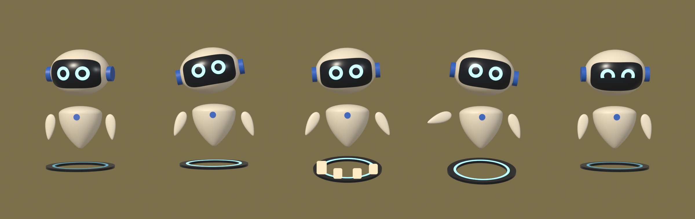

# Studio apprentice: design pack, v02

15 November 2026. Claude design lane, package A. First issued under `task_eb9bf20f2b46`; repaired under `task_a15de6eea874`. Written under `design/assistant/robot/apprentice/` only.

**Status.** Owen chose the eager apprentice personality. v01 of this pack was independently reviewed and returned **REVISE**: [../review/blockout-v01/review.md](../review/blockout-v01/review.md). This is the v02 repair. The independent recheck returned **PASS for the isolated v02 concept only**: [../review/blockout-v02/review.md](../review/blockout-v02/review.md).

Not covered by that pass, and still open:

- **Appearance** is not approved. That is Owen's decision; the closer-set eyes are the main thing to look at.
- **The room** is not verified. Nothing shows the robot in the Studio, under its lighting or at its real viewing angle, and the placement (zone A) is still a proposal.
- **Runtime behaviour** is not verified. Stills cannot show timing, one-frame clearing or reduced motion.
- **Budgets** are not measured.

**Text alignment after the recheck (`task_1570c9c22e81`).** The current documents now follow [root's checkpoint D1](../integration-decisions.md) and Codex's [state contract](../integration/state-contract.md). No geometry, script, `.blend` or render changed.

| Point | Now |
| --- | --- |
| Zero hits | A zero-hit `retrieval` stays in the waiting pose with the response pending. No match starts only on the valid abstained `answer` |
| More than four hits, or abstained with hits | Recoverable protocol errors that clear every view. No truncation, no partial display |
| Cards in the room | Display only. Selection comes through the HTML chips and list; the selected card's lift is only a mirror of that |
| Focus and modal | Heading focus on desktop and phone. Root owns the one modal; the Ask panel is a controlled view with no dialog or request flow of its own |
| Clearance box | 0.42 x 0.28 x 0.52 m, centred 0.04 below the root and 0.012 toward the front (Blender -Y). Held poses only; no swept envelope measured |

Primitive blockout on a stand-in backdrop. Left to right: idle, attention (also waiting), sources, no match, dismissal. The cards are static illustrations, not real search results.

## Contents

| File | What it is |
| --- | --- |
| [design-spec.md](design-spec.md) | v02. Change table, dimensions, facing assumption, face, parts, palette, poses, timing, tray rule, reduced motion, gaps |
| [storyboard.md](storyboard.md) | v02. Turnaround, state sheet, tray positions, five storyboards, timeline frames, state table |
| [ui-and-state-spec.md](ui-and-state-spec.md) | v02. Entry, panel, tray strip, one-hit-list rule, state map, reduced motion, proposals for Codex |
| [production-prompts.md](production-prompts.md) | Higgsfield and Meshy inputs, pointed at v02 renders. Nothing submitted |
| [blockout-v02/README.md](blockout-v02/README.md) | v02 scene passport, hashes, render list, measurements, what was and was not viewed, limitations |
| [blockout-v02/](blockout-v02/) | v02 `.blend`, build script, 49 renders |
| [blockout/](blockout/README.md) | **v01 evidence, untouched:** the `.blend`, script, passport and 25 renders the review cites |
| [v01-docs/](v01-docs/README.md) | **v01 evidence:** byte-identical copies of the five reviewed documents, with hashes |

## Review findings and where each is answered

| # | Finding | Answer | Evidence |
| --- | --- | --- | --- |
| 1 | Idle reads as a glare; far eye cut off | Upper lid removed; head turn 12 degrees; eyes closer; wider visor; no sideways eye slide | [phone idle](blockout-v02/renders/proxy-phone-390x844-fov64-idle-crop240.png), [pose](blockout-v02/renders/pose-idle.png), [oblique](blockout-v02/renders/oblique35-close-idle.png) |
| 2 | No-match fin points away from the panel | Pose mirrored; both documents say viewer's left; facing assumption stated in design-spec section 2 | [pose](blockout-v02/renders/pose-no-match.png), [phone](blockout-v02/renders/proxy-phone-390x844-fov64-no-match-crop240.png) |
| 3 | Stale cards: "at once" against 130 ms; entry stagger | One rule: zero old cards on the first rendered frame after the change; all N new cards together. design-spec section 8, UI spec section 3 | [frame 51](blockout-v02/renders/timeline-f051.png), [frame 101](blockout-v02/renders/timeline-f101.png) |
| 4 | Reduced motion only applied to the next state | On mid-gesture: next frame is the settled still. Off: no motion. design-spec section 9, UI spec section 7 | Text only |
| 5 | Empty lit tray meant both waiting and no match; resubmit had no pose | Tray carried against presented; robot entry in every state row; resubmit uses attention | [waiting](blockout-v02/renders/diag-fins-hidden-phone-attention-crop240.png), [no match](blockout-v02/renders/diag-fins-hidden-phone-no-match-crop240.png) |
| 6 | Body tip touches the tray | Tray lowered, tilt reduced. Measured 7.7 px or more at phone size, 9.1 px or more in three-quarter | [sources](blockout-v02/renders/proxy-phone-390x844-fov64-sources-crop240.png), [three-quarter](blockout-v02/renders/three-quarter-sources.png) |
| Docs | Material count, rigid-eye rationale, 49%, eye spacing, timing sums, "on axis" | Corrected in design-spec sections 2, 3, 5, 7 | Text |
| Notes | Lid seam; cards merging with glow; fin toward tray; rank by size | Seam gone with the lid; glow moved inward and cards made matte; fin claim dropped; size called decorative | [sources pose](blockout-v02/renders/pose-sources.png) |
| Evidence | Dismissal at phone size; an oblique proxy | Both added | [dismissal](blockout-v02/renders/proxy-phone-390x844-fov64-dismissal-crop240.png), [oblique sources](blockout-v02/renders/oblique35-phone-390x844-fov64-sources-crop240.png) |

Not addressed: the visor highlight and the slightly ragged visor edge remain.

## Checks made

- Read the full review and viewed the v01 reference and renders it cites before changing anything.
- Blender session checked by readback before writing: untitled, not dirty, default objects only.
- v02 `.blend` saved and read back; values match the script. Script passes `python -m py_compile`; its command-line entry was not executed.
- v01 `.blend`, script, passport and 25 renders: hashes unchanged.
- Viewed 36 of the 49 v02 renders after the final build; the 13 not viewed are listed in the [v02 passport](blockout-v02/README.md).
- Relative links in the current documents resolve, rechecked after the alignment edit.
- After the alignment edit, every file in `blockout/`, `blockout-v02/` (`.blend`, script, 49 renders) and `v01-docs/` has the same SHA-256 as before it.

No app build, motion test or runtime test was run. Nothing in the application changed. Stills cannot show that the timing or the one-frame rules work in the app.

## Open tradeoffs

| Tradeoff | Waits on |
| --- | --- |
| Closer-set eyes and no sideways glance change the face | Owen |
| The robot must be turned to face the fixed eye, or the cards overlap in the oblique view | Owen and step D |
| Clearance volume grew to 0.42 x 0.28 x 0.52 m because the tray sits lower; it must be checked against room objects and screen occlusion | Placement and the in-room proof |
| State rules are specified and aligned with D1, but not implemented or tested | Codex's [integration handoff](../integration/integration-handoff.md) and [verification matrix](../integration/verification-matrix.md) |
| The asset contract still transcribes v01 parts; v02 has no upper lid and eight moving nodes | Codex's [asset contract](../asset-pipeline/asset-contract.md) and [readiness note](../asset-pipeline/readiness.md); root has recorded it |
| Whether the selected card keeps its display-only lift | Root and Codex |
| Room, lighting, budget, baked or runtime cards | Unchanged from v01: root, Codex, plan steps D and E |
| Any Higgsfield or Meshy job | Owen's go-ahead on a current quote |
