# Studio apprentice: character design spec, v02

15 November 2026. Claude design lane, package A. v02 repair, `task_a15de6eea874`.

**Status.** Owen selected the eager apprentice personality. Everything else here is my proposal. v02 answers the independent review of v01, which returned REVISE: [../review/blockout-v01/review.md](../review/blockout-v01/review.md). The independent recheck of v02 returned **PASS for the isolated concept only**: [../review/blockout-v02/review.md](../review/blockout-v02/review.md). That pass does not cover appearance (Owen's decision), the robot in the room, runtime behaviour or budgets; none of those is approved or verified.

After the recheck I made one text-only alignment to [root's checkpoint D1](../integration-decisions.md) and Codex's [state contract](../integration/state-contract.md): the no-match trigger, the selected-card cue, the clearance depth offset and the stale notes about missing directories. No geometry, pose, script or render changed. The v01 text of this document is kept unchanged in [v01-docs/](v01-docs/README.md) and the v01 blockout in [blockout/](blockout/README.md).

Values marked **T** are tunable. Items marked **P** depend on final placement.

**What I looked at.** [The reference](../reference/robot-inspiration.png), the review, the v01 renders it cites, the reviewer's enlarged phone aid, and the v02 renders linked below, which come from [blockout-v02/](blockout-v02/README.md).

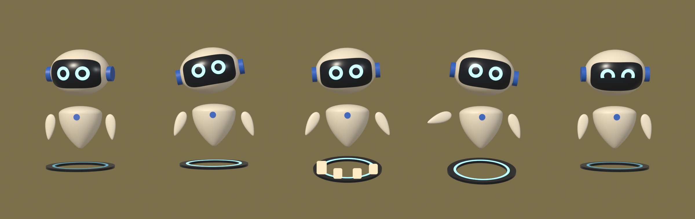

Left to right: idle, attention (also the waiting pose), sources, no match, dismissal. Primitive blockout on a stand-in backdrop, not the Studio room. **The cards are static illustrations placed by the build script. They are not connected to any real search.**

## 0. What changed from v01

| Review item | Change |
| --- | --- |
| 1. Idle glare, far eye cut off | The upper lid is removed from the design. Idle shows two whole rings. Head turn reduced from 22 to 12 degrees. Eyes moved inward (centres 0.068 apart, was 0.087). Visor widened. The eye rig no longer slides sideways |
| 2. No-match point | Points with fin R, the viewer's left, the same side as the proposed desktop panel. Head roll mirrored with it. Facing assumption written down in section 2 |
| 3. Stale cards | One rule: tray contents change in a single frame, in both directions. No card tween, no stagger. Sections 7, 8, 10 |
| 4. Reduced motion mid-gesture | Turning it on snaps to the settled still on the next frame. Turning it off starts nothing. Section 9 |
| 5. Empty lit tray meant two things | The tray now has two positions. Carried (flat, high) means nothing to show yet. Presented (lower, forward, tilted) appears only with a result. Resubmit has an explicit pose. Section 6 |
| 6. Body tip touching the tray | Tray lowered and presenting tilt reduced. Measured gap at phone size is 7.7 px or more in the presenting poses. Section 2 |
| Document mistakes | Material count, rigid-eye rationale, head percentage, eye spacing, timing sums and the "on axis" wording are corrected in sections 2, 3, 5 and 7 |
| Lower-priority notes | Lid seam gone with the upper lid. Tray glow moved to the inner edge so cards and glow no longer merge. Cards no longer glow. The "fin toward the tray" claim is dropped; sources uses two open fins. Rank by card size is now described as decorative |

## 1. Character in one paragraph

A junior archivist that carries a card tray. It keeps the reference's four features (ring eyes on a dark visor, a head that floats apart from the body, two small fins, a ring underneath) and drops the wireframe. The ring is its tray; whatever the search really returned stands on it as index cards. It is warm: it perks up when addressed, smiles at hello and goodbye, and hands things over keenly. It never signals that a passage is right. Its pleasure is about the visitor and the errand, and it is the same for one card or four.

## 2. Silhouette, proportions and facing

Three light masses on a dark-ish wall, stacked: wide head, shield body, tray. Both gaps (head to body, body to tray) stay open in every pose.

| Measure | Value (m) | Note |
| --- | --- | --- |
| Overall, neutral | 0.264 W x 0.236 D x 0.422 H | Measured from the v02 file |
| Largest pose extents | 0.342 W (no match), 0.477 H (sources) | Lowest point -0.286, highest +0.206, relative to the hover root |
| Clearance volume to reserve | 0.42 W x 0.28 D x 0.52 H | **T**, **P**. Centred 0.04 below the hover root and 0.012 in front of it (see below). The pointing fin tip reaches 0.192 from centre, leaving 18 mm |
| Head | 0.21 W x 0.16 D x 0.16 H | 46% of the 0.346 head, gap and body stack |
| Head/body gap | 0.036 | |
| Body | 0.15 W x 0.12 D x 0.15 H | Round shoulder, tapers to a soft point |
| Fin | 0.090 long x 0.038 wide x 0.013 thick | Floats 0.008 off the body |
| Tray | 0.236 outer, 0.172 inner, 0.008 thick | Carried: centre 0.228 below the root, tilt 6 degrees. Presented: 0.242 below, 0.03 forward, tilt 20 degrees |
| Eye ring | 0.046 outer, 0.026 inner | Centres 0.068 apart (origins at +/-0.0342), 0.022 between the rings |

Scale in the Studio is 2 scene units per metre, applied once by a placement wrapper outside this asset.

**Where the clearance box sits.** All offsets are from `APR_root`, in the Blender authoring axes: Z up, and the character's front is **-Y**.

| Axis | Box centre | Box range | What sets it |
| --- | --- | --- | --- |
| Width (X) | 0 | -0.21 to +0.21 | The no-match fin tip at -0.192 |
| Depth (Y) | **-0.012**, that is 0.012 toward the front | -0.152 to +0.128 | The tray: front edge at -0.142 when presented, rear edge at +0.118 when carried |
| Height (Z) | **-0.04**, that is 0.04 below the root | -0.30 to +0.22 | Lowest point -0.286, highest +0.206 |

Depth arithmetic, from the v02 script values (`TRAY_RO` 0.118, `TRAY_T` 0.008, carried tilt 6 degrees at y 0, presented tilt 20 degrees at y -0.03):

- Carried: half-depth 0.118 x cos 6 + 0.004 x sin 6 = 0.118. Range -0.118 to +0.118.
- Presented: half-depth 0.118 x cos 20 + 0.004 x sin 20 = 0.112. Range -0.03 - 0.112 = -0.142 to -0.03 + 0.112 = +0.082.
- Both together: -0.142 to +0.118, which is 0.260 deep with its middle at -0.012. The 0.28 box leaves 10 mm front and back.

These agree with the depths measured from the saved file (0.236 carried, 0.225 presented). The reviewer suggested about 0.03 forward. That centres the presented tray alone; a 0.28 box there would end at +0.11 and cut the carried tray's rear edge by 8 mm, so I use 0.012. A box centred on the root in depth, as v02 first implied, is 2 mm short at the front.

This box covers the held poses. I have not measured a full swept envelope of the motion between them, and easing overshoot is not included.

**Facing assumption (R1).** The placement wrapper turns `APR_root` so the robot's front points at the fixed eye. Everything in this spec that says "viewer's left" or "viewer's right" assumes R1. Under R1:

- the viewer's left is the character's right (R, -X in the authoring file);
- from zone A, the viewer's left is toward the desk, Owen's screens and the proposed left-hand panel;
- the head-on proxies below are the view.

If the wrapper instead leaves the robot facing straight out from the wall, the eye sees it from about 35 degrees on the character's right. The oblique renders in this pack show that case. R1 is my proposal for step D; it is not settled.

**Expected size on screen (computed, P).** I assumed an anchor of about `[2.1, 3.05, -0.6]` scene units, 2.44 m from the fixed eye, derived from the pilot speaker position at `components/studio/scene/build-studio.ts:374` in the read-only Studio checkout, not from the M3 room. That anchor is about 35 degrees to the right of straight ahead from the eye. The proxies put the robot at the centre of the frame, as when a visitor looks at it. Near the edge of the frame it would be drawn somewhat larger and stretched; I have not modelled that. At frame centre the robot is about 140 px tall at 1440x900 with the 58-degree lens and about 117 px at 390x844 with production's 64-degree lens.

Phone-size proxies at production's 64-degree lens, robot alone, cropped at native resolution:

| | Idle | Attention / waiting | Sources | No match | Dismissal |
| --- | --- | --- | --- | --- | --- |
| Head-on (R1) | 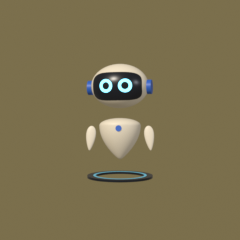 | 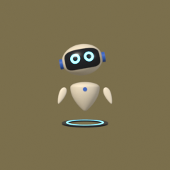 | 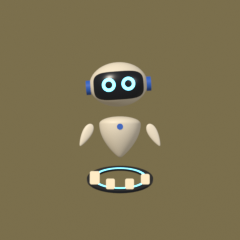 | 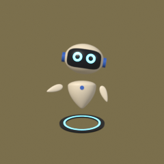 | 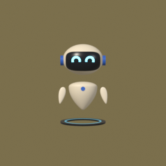 |
| 35 degrees oblique (not R1) | 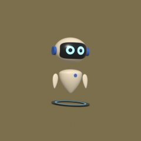 | 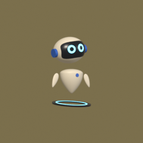 | 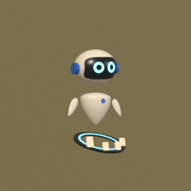 | 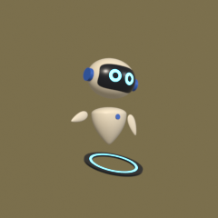 | 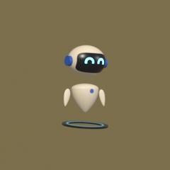 |

Desktop proxies are in the [render list](blockout-v02/README.md).

**Body-to-tray gap, measured.** I projected the body's lowest point and the tray's highest point beneath it through each camera in the v02 file.

| Pose | Phone head-on | Phone oblique | Desktop head-on | Three-quarter, 700 px frame |
| --- | --- | --- | --- | --- |
| Idle | 11.0 px | 11.4 px | 13.3 px | 11.7 px |
| Attention | 11.0 px | 11.4 px | 13.3 px | 12.5 px |
| Sources | 7.7 px | 8.1 px | 9.3 px | 9.5 px |
| No match | 7.7 px | 8.0 px | 9.2 px | 9.1 px |

What I see in the phone crops: eyes, both gaps and the tray read. Four cards can be counted head-on. The goodbye smile reads. The larger first card cannot be told apart. In the oblique sources crop the two cards on the far side overlap, so the count is harder to read; that is a reason to adopt R1.

## 3. Face and eyes

The face changes shape using rigid parts that only rotate. This is a provisional design choice. It keeps the asset to plain transforms, with no morph targets, skins or transparency, and so avoids the profile and cost review those features would need. The robot gets its own asset profile; the room profile does not govern it, and nothing forbids a morph-based face if step D prefers one.

- **Visor.** A dark inset band on the front of the head: a rounded rectangle 0.176 wide and 0.099 tall, wrapped on the head surface.
- **Eyes.** Two emissive rings, raised about 0.5 mm above the visor and about 0.8 mm thick. They never change shape, and in every held pose both are whole.
- **Lower lid.** One visor-coloured plate below the eyes, about 1.8 mm above the visor. Raised 15 degrees it covers the bottom half of both rings, leaving two arches: the smile. It is the only lid.
- **No upper lid.** v01 had one for a half-closed idle look. It read as a glare, and its plate showed as a seam across the visor. It is removed, not hidden.
- **Gaze.** The eye pivot (`APR_eyes`) pitches up to 7 degrees so the rings look down at the tray. It does not turn sideways: on this head a sideways slide sinks the outer ring into the visor, which is part of what clipped the far eye in v01. Looking sideways is done by turning the head. **T**
- **Why the head is this shape.** Depth equals height (0.16), so the head is a surface of revolution about the ear axis and the lid and eye pivot stay on the surface as they pitch. Keep this if the head is restyled.
- **Asset requirement.** On the open-eyed face at close-up there is no visible lid edge, and the visor outline is clean.

Checked in v02: idle from the front ([pose](blockout-v02/renders/pose-idle.png)), from three-quarter with the head turned away from the camera ([render](blockout-v02/renders/three-quarter-idle.png)) and from 35 degrees oblique ([render](blockout-v02/renders/oblique35-close-idle.png)). Both rings are closed loops in all three. In the three-quarter view the far ring is foreshortened to a narrow oval but not cut.

## 4. Parts, parents and origins

Metres, Blender Z up, character faces -Y. L and R are the character's own sides: L is +X, which is the viewer's right under R1. Positions are relative to the parent. Names match the v02 file.

| Part | Parent | Origin (x, y, z) | Moves | Notes |
| --- | --- | --- | --- | --- |
| `APR_root` | placement wrapper | hover root, centre of the head/body gap | z lift up to 0.012 | The only node the wrapper scales, turns and places |
| `APR_head` | `APR_root` | 0, 0, +0.018 (head base) | pitch, roll, yaw | |
| `APR_visor` | `APR_head` | head centre 0, 0, +0.08 | none | Can be merged into the head |
| `APR_ear_L`, `APR_ear_R` | `APR_head` | head centre | none | Accent discs. Can be merged |
| `APR_eyes` | `APR_head` | head centre | pitch only | Empty pivot |
| `APR_eye_L`, `APR_eye_R` | `APR_eyes` | +/-0.0342, -0.0772, 0 | none | Emissive rings |
| `APR_lid_lower` | `APR_eyes` | head centre | rotate about X | The smile |
| `APR_body` | `APR_root` | 0, 0, -0.018 (body top) | yaw, small pitch | |
| `APR_badge` | `APR_body` | 0, -0.0594, -0.039 | none | Accent dot. Can be merged |
| `APR_fin_L`, `APR_fin_R` | `APR_body` | +/-0.102, 0, -0.028 (hinge) | forward swing, outward splay | |
| `APR_tray` | `APR_root` | 0, 0, -0.228 (centre) | tilt about X, z and y | |
| `APR_tray_glow` | `APR_tray` | centre | none | Emissive strip on the inner edge |
| `APR_card_1` to `_4` | `APR_tray` | on the band at -56, -18, +18, +56 degrees from front | present or absent | **Illustrations.** In the product, cards are created at runtime from real hits |

Moving set: root, head, eye pivot, lower lid, body, two fins, tray. Eight transform nodes.

## 5. Materials and palette

| Material | Hex | Finish | Used on | In the robot asset |
| --- | --- | --- | --- | --- |
| `MAT_APR_shell` | `#EFE7D6` | Matte, roughness 0.5 | Head, body, fins | Yes |
| `MAT_APR_ink` | `#151B26` | Satin, roughness 0.3 | Visor, lid, tray band | Yes |
| `MAT_APR_accent` | `#2F66D0` | Matte, roughness 0.45 | Ear discs, chest dot | Yes |
| `MAT_APR_eye_emit` | `#7FE3FF` emissive | Strength 3 in Blender | Eye rings | Yes |
| `MAT_APR_tray_glow` | `#7FE3FF` emissive | Two brightness levels: dim 0.5, lit 2.5 | Tray strip | Yes, one material |
| `MAT_APR_card` | `#F4E8CC` | Matte, almost no emission | Source cards | No. It belongs to the runtime cards |

**Count.** The robot asset has five materials. The cards add a sixth, outside the asset. The blockout file holds eight material datablocks: those six, a second copy of the tray glow for the lit level, and the stand-in backdrop.

All opaque, no textures. All **T**. Emissive strengths are Blender values and need re-tuning in three.js under the room's final lighting. No state is carried by colour alone.

## 6. Poses

Angles in degrees. Head: pitch + nods down, roll + tips the crown to the character's left, yaw - turns to the viewer's left. Fin: forward swing, outward splay. All **T**.

**The tray has two positions, and they mean different things.**

- **Carried:** flat (6 degrees), close under the body. Seen from the eye it is a thin hoop. It means "nothing to show": idle, waiting, resubmitting, stopped, leaving.
- **Presented:** lower, 0.03 toward the viewer, tilted 20 degrees so its face shows as an open oval. It appears only when a real result exists: with cards when `retrieval` brings 1 to 4 hits, and empty only once the valid abstained `answer` has arrived. A `retrieval` with 0 hits by itself leaves the tray carried.

Glow is an extra cue, not the distinction. With both fins hidden, the two positions are still easy to tell apart at phone size: [waiting](blockout-v02/renders/diag-fins-hidden-phone-attention-crop240.png), [no match](blockout-v02/renders/diag-fins-hidden-phone-no-match-crop240.png).

| | Idle | Attention / waiting | Sources | No match | Dismissal |
| --- | --- | --- | --- | --- | --- |
| Render | [idle](blockout-v02/renders/pose-idle.png) | [attention](blockout-v02/renders/pose-attention.png) | [4 cards](blockout-v02/renders/pose-sources.png), [1 card](blockout-v02/renders/pose-sources-1.png) | [no match](blockout-v02/renders/pose-no-match.png) | [dismissal](blockout-v02/renders/pose-dismissal.png) |
| Meaning | Minding the desk | "Yes? I'm listening" | "Here is what I fetched" | "Nothing on the tray. Owen is that way" | "Bye!" then back to the desk |
| Root lift | 0 | +0.008 | +0.006 | 0 | 0 |
| Head | 2, 0, -12 **P** | -3, -10, 0 | 5, -4, 0 | 0, 8, 0 | 10, 0, 0 |
| Eye pivot pitch | 2 | 0 | 0 | 0 | 0 |
| Eyes | whole rings | whole rings | whole rings | whole rings | lower lid 15 (smile) |
| Body yaw | -5 | 0 | 0 | 0 | 0 |
| Fin L | 0, 6 | 0, 22 | 0, 28 | 0, 20 | 0, 12 |
| Fin R | 0, 6 | 0, 22 | 0, 28 | 10, 70, pointing **P** | 0, 12 |
| Tray | carried | carried | presented | presented | carried |
| Tray glow | dim | lit | lit | lit | dim |
| Cards | none | none | one per real hit | none | none |

**Resubmit.** A new question sent while a result is showing uses the attention pose: cards gone on the next frame, tray eased back to carried, head and fins eased to attention. The robot never holds a presented empty tray while a request is in flight.

**Stopped** (cancel, timeout, error): the attention pose with the tray carried and dim.

Passing beats, not held states:

- **Greeting** (start of attention): lower lid 15 and fins 26, then the settled attention pose.
- **Glance** (start of sources and no match): head 14 down and eye pivot 7 down at the tray, then back to the visitor. [Render](blockout-v02/renders/pose-sources-glance.png).
- **Shrug** (inside no match): both fins out to 40 once before fin R points.

Placement dependencies, all under R1: the idle head turn points toward the viewer's left, where Owen's screens are from zone A. The no-match fin points to the viewer's left, where [ui-and-state-spec.md](ui-and-state-spec.md) puts the desktop panel and its contact link. If the panel moves to the right, mirror the no-match pose (fin L points, head roll -8).

## 7. Timing and easing

Runtime timings in milliseconds from the triggering event. All **T**. Search takes about 9 ms, so nothing here waits on it.

**Tray contents never animate.** Cards exist or do not exist. Only the robot's parts ease.

| Transition | Trigger | Beats (start to end) | Total |
| --- | --- | --- | --- |
| Idle to attention | Hover or focus on the robot or the Ask button; panel opens | Head 0 to 330. Body 90 to 470. Greeting smile held 0 to 300, released 300 to 500 | 500 |
| Attention to sources | `retrieval` with 1 to 4 hits | All N cards present on the first frame. Glance down 0 to 200. Tray to presented 0 to 270. Look back up 200 to 470 | 470 |
| Zero retrieved, response pending | `retrieval` with 0 hits | No motion. The robot stays in attention with the tray carried | 0 |
| Attention to no match | Valid abstained `answer` after a zero-hit `retrieval` | Glance down 0 to 200, tray to presented 0 to 270. Hold 200 to 270. Look up with head tilt 270 to 540. Shrug 540 to 740. Point 740 to 1140 | 1140 |
| Resubmit | New question while a result shows | Cards gone on the first frame. Pose and tray to attention 0 to 250 | 250 |
| Stopped | Cancel, timeout, error, 429, protocol error | Cards gone on the first frame. Tray dims at once. Pose and tray to attention 0 to 250 | 250 |
| Dismissal to idle | Panel closes | Cards gone on the first frame. Nod and smile 0 to 270. Hold 270 to 470. Return to idle 470 to 870 | 870 |
| Card selected | Selection changes in the HTML chips or list | The matching card lifts 0.006 and grows to 1.15, 0 to 120. Display only: the card mirrors the HTML selection and is never an input target | 120 |

Easing: arrivals use ease-out `cubic-bezier(0.22, 1, 0.36, 1)`. Returns to idle use ease-in-out `cubic-bezier(0.65, 0, 0.35, 1)`. Fins on the greeting may overshoot by up to 10%. Nothing loops and nothing bobs; idle is completely still.

The v02 file holds a 30 fps keyed version on `APR_master` (frames 0 to 230). It is a blocking reference built from stills; it is not a test of runtime motion. I still recommend that the runtime blend between named pose targets, a choice for step D.

## 8. Interruption and the tray rule

**The tray rule.** The tray, the panel's chips and the source list all show one hit list. That list changes in a single state update, and the same update asks for a render.

- When it empties (new submit, superseded request, cancel, failure, close, unmount), the first frame rendered afterwards draws no cards from the previous request. There is no exit tween.
- When a result arrives, the first frame rendered afterwards draws all N cards. There is no entry tween and no stagger.
- Testable form: on the first rendered frame after the state change, the number of cards drawn equals the current hit count, and none belongs to an earlier request.

Only the pose eases after that. For a few frames the robot may still be moving out of the sources pose with an empty tray; that is allowed, and [this frame](blockout-v02/renders/timeline-f101.png) shows it.

A new state always wins over an older gesture. Priority, highest first:

1. Dismissal or unmount.
2. Stopped (cancel, timeout, error, protocol error).
3. Resubmit (a new request replaces the old one).
4. Result for the current request only: sources on a `retrieval` with hits, no match on the valid abstained `answer`.
5. Attention.
6. Idle.

Rules:

- **Blend, do not restart.** A new pose target is reached from the current part positions over 160 to 250 ms.
- **Passing beats are skippable.** A result during the greeting skips the rest of the greeting.
- **Hover does not interrupt a result.** While the panel is open, hover and focus do not change the pose.
- **Stale results never show.** A late `retrieval` for a superseded request changes nothing.
- **Late arrival.** If the robot asset finishes loading, or a hidden tab becomes visible, while a state is current, the robot takes that state's settled still with no gesture.

## 9. Reduced motion

With reduced motion on, the robot swaps between stills in one frame.

**When the preference changes while the page is open:**

- **Turned on during a gesture:** the gesture is cancelled, remaining passing beats are skipped, and the next rendered frame is the settled still for the current state from the table below.
- **Turned off:** nothing moves. The robot stays in its still until the next real state change, which then animates normally.

| State | Still |
| --- | --- |
| Idle | Idle pose |
| Attention, waiting, resubmit | Settled attention pose, tray carried, no smile, no lift |
| Sources | Settled sources pose, tray presented, all real cards standing |
| No match | Settled no-match pose with fin R pointing, tray presented and empty |
| Zero retrieved, response pending | Settled attention pose, tray carried |
| Stopped | Attention pose, tray carried and dim |
| Dismissal | The idle pose |
| Card selected (mirror of the HTML selection) | Card at 1.15 scale, no lift tween |

## 10. Warmth without overclaiming

- Allowed and wanted: the perk-up, the greeting smile, the eager hand-over, the goodbye smile, the helpful point toward Owen.
- The hand-over looks the same for one hit as for four. Nothing scales with hit count or score.
- No smile, nod or tick is tied to a result arriving.
- No thinking act: no upward look, spinning tray or pulsing eyes.
- On every rendered frame the tray shows exactly the current hit count. It never shows cards before a real `retrieval`, and never shows cards from an earlier request.
- The no-match pose is a validated result. It never appears while a response is pending and never stands in for a failure.
- Cards in the room are display only. Nothing in the scene selects a source.
- Rank 1 stands first on the viewer's left. It is also drawn slightly larger, but that is decoration: it does not read at phone size and perspective distorts it. The numbered chips in the panel carry rank.
- No voice, name or speech bubble is assumed.

## 11. Gaps and what each one waits on

| Gap | Waits on |
| --- | --- |
| v02 passed independent recheck as an isolated concept only | Nothing further for the concept. The next useful review is the in-room proof |
| Appearance is not approved | Owen |
| Robot has not been seen in the room | Pinned room revision and camera, then the composition proof (plan step E) |
| Facing assumption R1, zone A, panel side | Owen and step D |
| Cards in the oblique view overlap | R1 being adopted, or a wider card spread |
| Closer-set eyes are a visible change of face | Owen's eye; widening them again brings back the far-eye risk |
| State behaviour is specified, not implemented | [root's checkpoint D1](../integration-decisions.md) and Codex's [state contract](../integration/state-contract.md) now govern; this document follows them. Runtime tests are in Codex's [verification matrix](../integration/verification-matrix.md) and have not been run |
| The asset contract still lists v01 parts | Codex's [asset contract](../asset-pipeline/asset-contract.md) and [readiness note](../asset-pipeline/readiness.md). v02 has no upper lid and eight moving nodes; root has recorded that the profile must be regenerated |
| Clearance box is for held poses only | A swept-envelope measurement, and a check against room objects at the chosen anchor |
| Baked or runtime cards, eyes and lid; pose blending or clips | Step D |
| Colours and emissive strength under real room light | M6 lighting; a browser test |
| Budgets | Codex measurement. The v02 blockout is 12,852 triangles, unoptimised, and is not a budget claim |
| Lid is a single-sided sheet in the blockout | Cleanup |
| No motion, app or runtime test exists | Implementation. The timeline is stills only |
