# Studio apprentice: storyboard and state sheet, v02

15 November 2026. Claude design lane, package A. v02 repair after the [v01 review](../review/blockout-v01/review.md). The [v02 recheck](../review/blockout-v02/review.md) returned PASS for the isolated concept only. Appearance, the room, runtime behaviour and budgets are not approved or verified. State triggers below follow [root's checkpoint D1](../integration-decisions.md). The v01 text is kept in [v01-docs/](v01-docs/README.md).

All images are renders of the primitive blockout in [blockout-v02/](blockout-v02/README.md) against a flat stand-in backdrop. They show the robot alone, not the Studio room, the panel or real lighting. **The cards in these images are static illustrations placed by the build script. They are not connected to real search results.** Pose values and timing are in [design-spec.md](design-spec.md); panel behaviour is in [ui-and-state-spec.md](ui-and-state-spec.md).

"Viewer's left" throughout assumes the robot is turned to face the fixed eye ([design-spec.md section 2](design-spec.md)).

## Turnaround, neutral pose

| Front | Three-quarter | Side |
| --- | --- | --- |
| 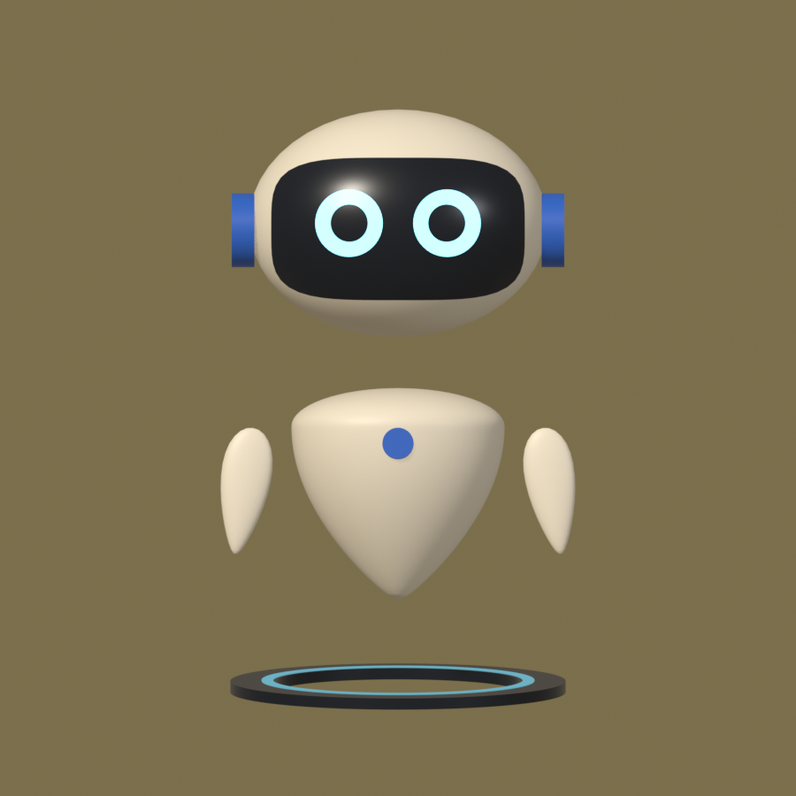 | 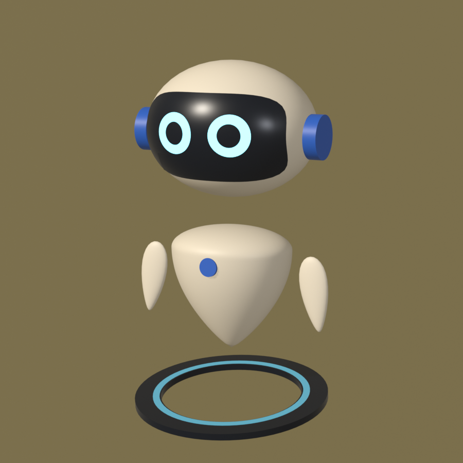 | 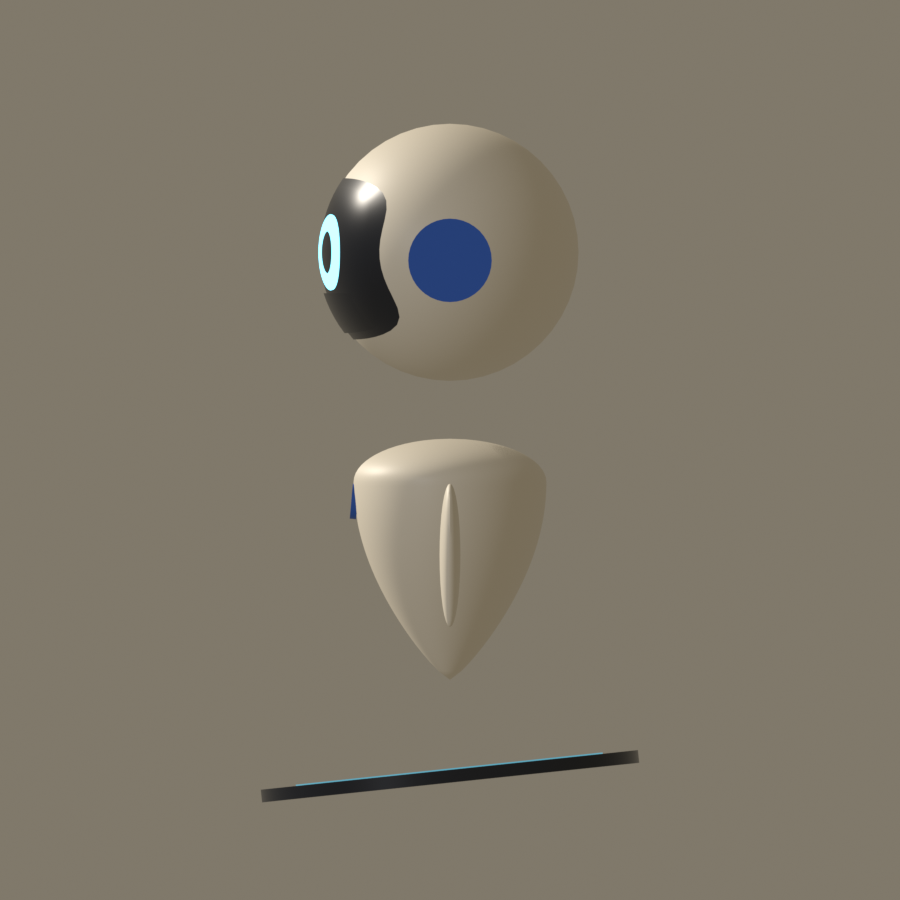 |

Front and side are orthographic at the same scale. The side view shows the fins edge-on, the visor wrap and the tray carried at its 6-degree tilt.

## State sheet

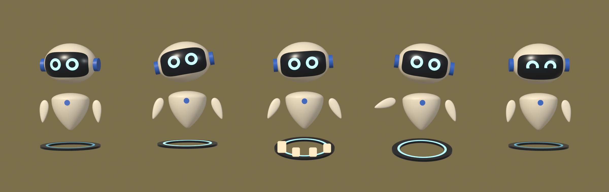

Idle, attention (also waiting), sources with four illustrated cards, no match, dismissal. The camera is 0.10 m below the hover root, close to the assumed Studio eye height.

## The tray's two positions

| Carried: nothing to show yet | Presented: a result exists |
| --- | --- |
| 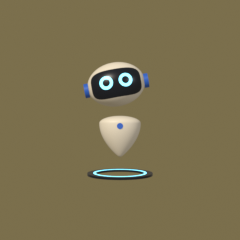 | 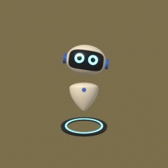 |
| Waiting. Tray flat and close under the body: a thin hoop. | No match, after the abstained answer. Tray lower, forward and tilted toward the visitor: an open, empty oval. |

Both crops are at phone size with the fins hidden, to show that the difference does not depend on the fins or on colour. The head also differs (cocked one way when waiting, tipped the other way for no match).

## Storyboard

### A. A visitor asks and sources come back

| 1. Idle | 2. Addressed, then waiting | 3. Sources arrive | 4. Settled |
| --- | --- | --- | --- |
| 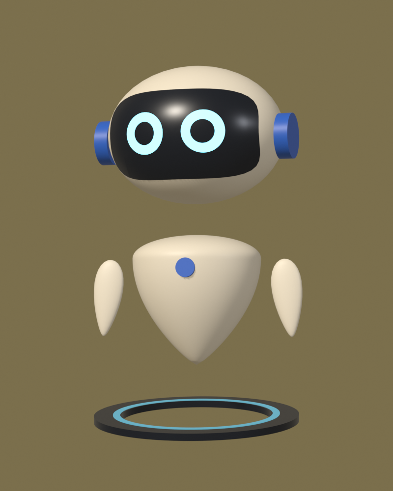 | 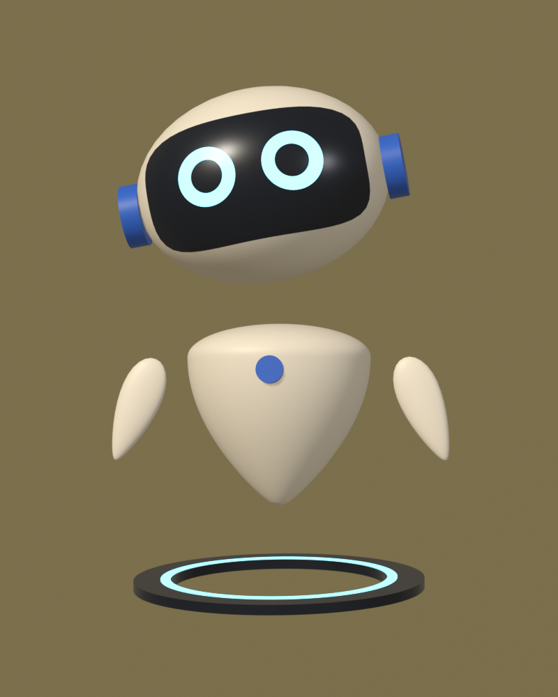 | 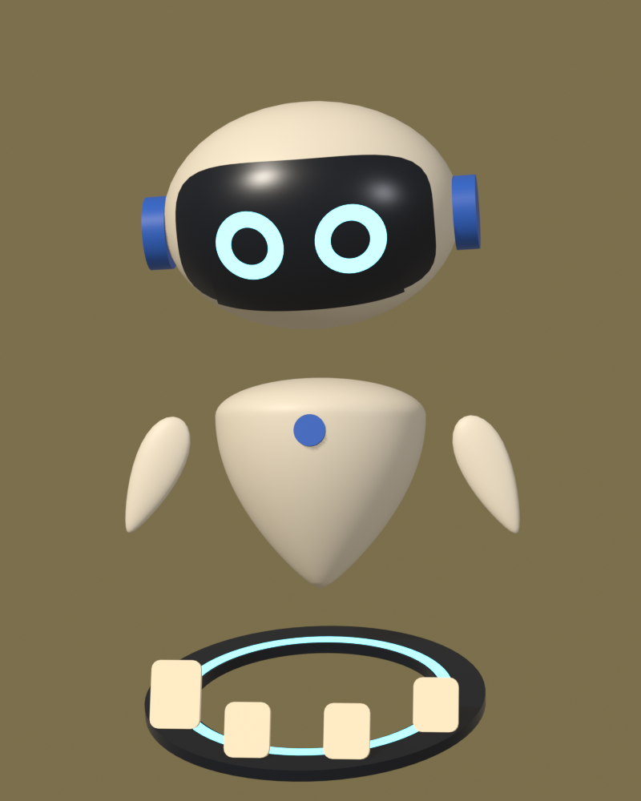 | 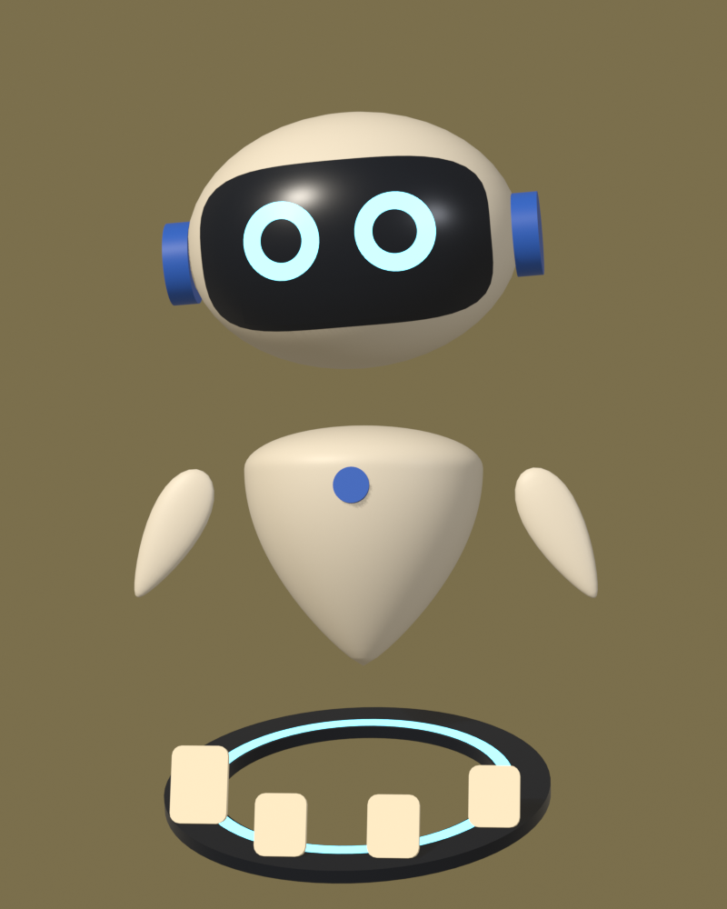 |
| Head turned a little toward Owen's screens. Round, open eyes. Tray carried, dim. Completely still. | Hover, focus or the Ask button. Head turns and cocks, body follows, fins open, tray lights but stays carried. A short smile, then round eyes. It holds this while a question is in flight. | The real `retrieval` event arrives. Every card is already standing on the first frame. It glances down as the tray comes forward. | It looks back at the visitor with both fins open. Cards stay until the panel closes or a new question replaces them. |
| Trigger: none | Trigger: pointer, focus or panel open | Trigger: `retrieval`, 1 to 4 hits | Holds |

A question in flight has no thinking pose. The robot keeps attending, tray carried. The cards are for looking at only: a visitor selects a source with the chips or the list in the panel, and the matching card may lift to mirror that.

One hit: same pose, same eagerness, one card.

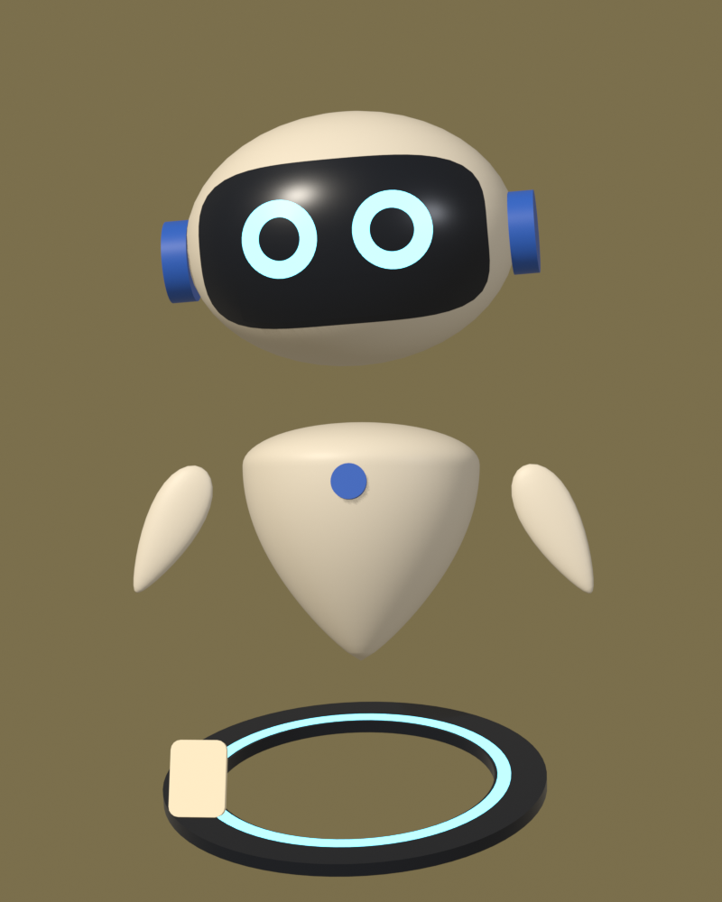

### B. Nothing matches

| 1. Waiting | 2. Shrug | 3. Points to Owen |
| --- | --- | --- |
|  | 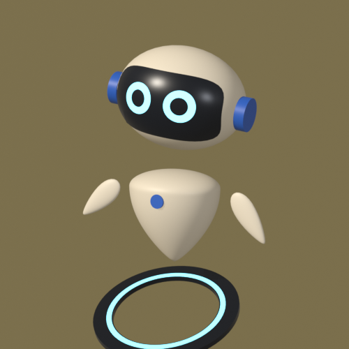 | 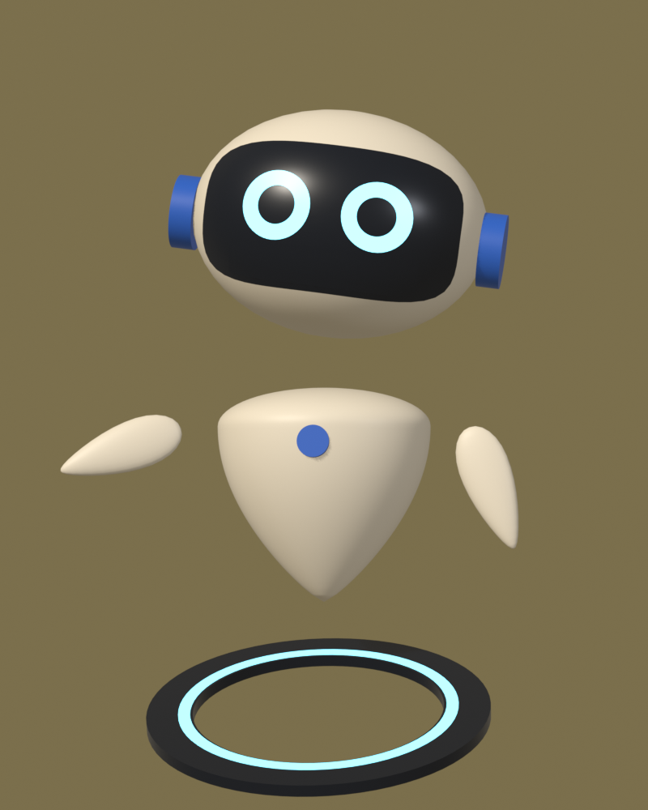 |
| As above. A `retrieval` with 0 hits changes nothing here: the robot keeps waiting, tray carried, until the answer arrives. | The valid abstained `answer` arrives. It presents the empty tray, glances at it, looks up with the head tipped, and opens both fins once. | The fin on the viewer's left points toward the panel and its contact link. Eyes stay round. The tray stays presented and empty. |

No sad face and no apology loop. The panel carries the server's message and the contact link.

### C. The visitor asks again while a result is showing

| 1. Result showing | 2. Next frame | 3. Waiting |
| --- | --- | --- |
|  | 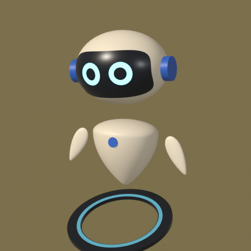 |  |
| Cards from the last question. | The new question is sent. Every old card is gone on the next rendered frame. The pose has only begun to move. | Within 250 ms it is back in the waiting pose with the tray carried. The new result arrives as in A or B. |

Image 2 is from the dismissal part of the keyed timeline, which is the only place the blockout keys this moment. It illustrates the rule (tray empty at once, pose still easing); the resubmit transition itself is not keyed.

### D. The visitor leaves

| 1. Any state | 2. Goodbye | 3. Idle |
| --- | --- | --- |
|  | 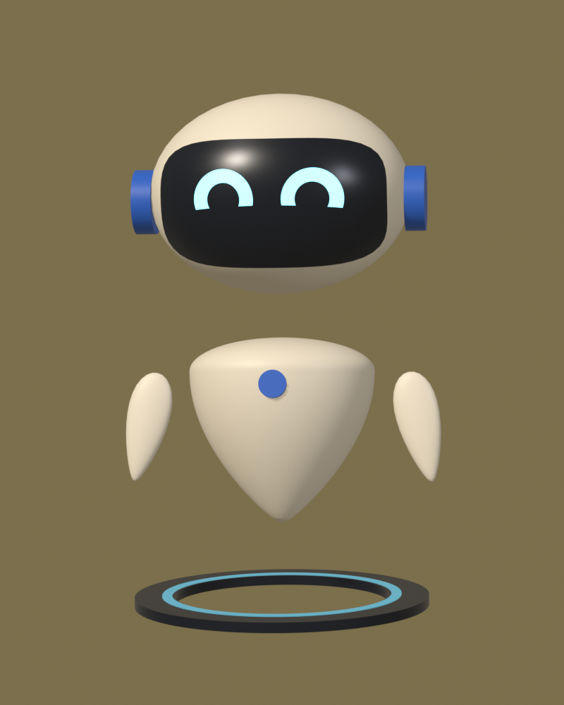 |  |
| Escape or Close. | Cards are gone on the next frame. One nod with a smile. | Back to the desk. Nothing from the last result stays on show. |

The smile at phone size: 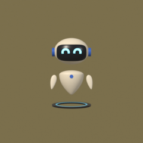

### E. Stopped: cancel, timeout, error, too many requests

This includes a protocol error, such as more than four hits or an abstained answer that arrives with hits. No new pose. Cards are gone on the next frame, the tray dims and returns to carried, and the robot eases to the attention pose. It does not shrug or present an empty tray, because a failed request is not "nothing matched". The panel shows the existing notice and Try again.

## Frames from the keyed timeline

From the 30 fps blocking on `APR_master`, three-quarter camera. They show parts in transit. They are stills; they do not test motion in the app.

| Frame 15 | Frame 25 | Frame 51 | Frame 57 | Frame 101 | Frame 176 |
| --- | --- | --- | --- | --- | --- |
| 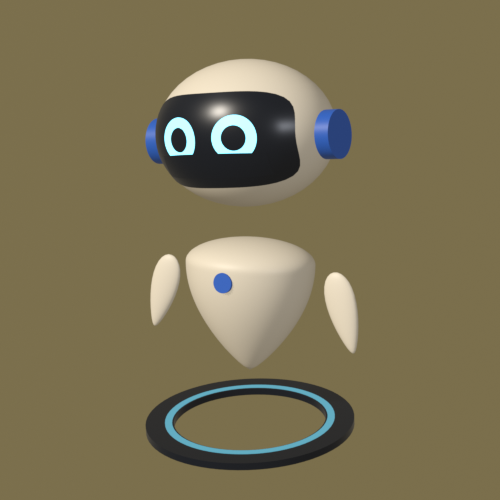 | 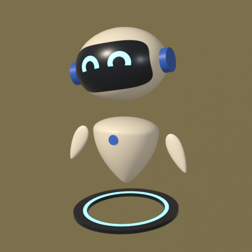 | 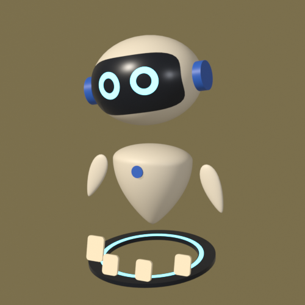 | 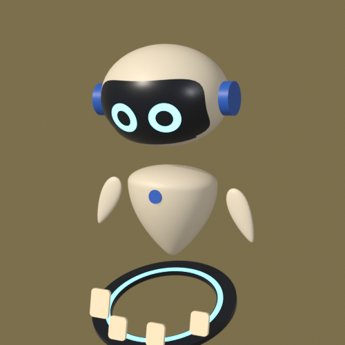 |  |  |
| Turning from idle to the visitor | Greeting smile | First frame after the result: all four cards present, pose barely changed | Glance down at the tray | First frame after close: no cards, pose still leaving sources | Shrug settling into the point |

Read back from the file: cards are hidden at frame 50 and all four shown at frame 51; all four shown at frame 100 and all hidden at frame 101. No card is ever partly shown.

## State table

One row per real event or client condition. The robot columns are the only thing the 3D layer does. Every row has a robot pose.

| State | Real trigger | Pose | Tray position | Glow | Cards |
| --- | --- | --- | --- | --- | --- |
| Idle | Panel closed, no hover or focus | Idle | Carried | Dim | None |
| Attention | Hover, focus, or panel open with no result | Attention | Carried | Lit | None |
| Waiting | Request sent, or `retrieval-start` | Attention (unchanged) | Carried | Lit | None |
| Zero retrieved, response pending | `retrieval` with 0 hits | Attention (unchanged) | Carried | Lit | None |
| Sources | `retrieval` with 1 to 4 hits | Sources | Presented | Lit | Exactly one per hit, all on the first frame, rank 1 on the viewer's left |
| No match | Valid abstained `answer` after a zero-hit `retrieval` | No match | Presented | Lit | None |
| Finished | `done` | Unchanged | Unchanged | Unchanged | Unchanged |
| Resubmit | A newer question was sent | Attention | Carried | Lit | Old cards gone on the next frame |
| Stopped | Cancel, 60 s timeout, connection error, 429, malformed stream, protocol error (more than four hits, abstained with hits) | Attention | Carried | Dim | Gone on the next frame |
| Dismissed | Escape, Close, unmount | Dismissal, then idle | Carried | Dim | Gone on the next frame |

## What I viewed

Every image linked on this page, after the final v02 build. Things I noticed that are not fixed:

- The visor still shows a soft highlight from the review lighting.
- The visor's lower edge is slightly ragged in close-ups. It is a blockout artefact.
- In the three-quarter frames the far eye ring is a narrow oval. It is whole, but it is small.
