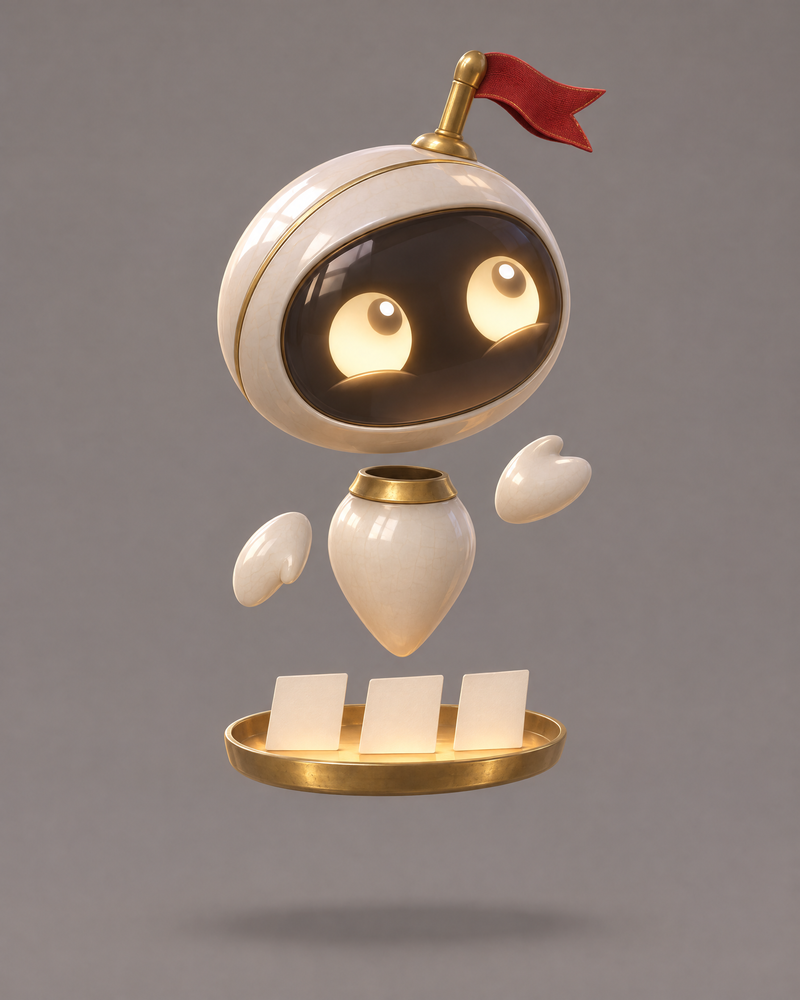
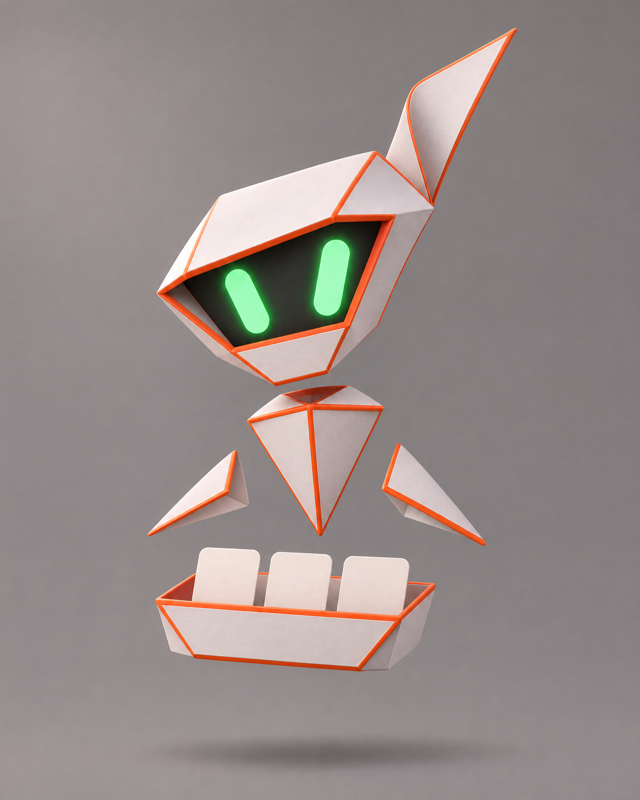
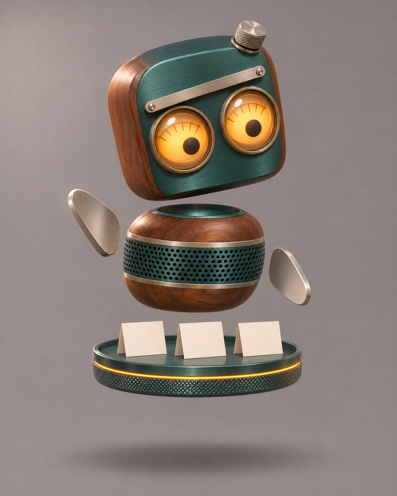

# Apprentice character concepts, round 1 (Higgsfield)

16 November 2026. Claude visual-design lane, `task_89ee276dbf32`, plan steps H0 and H1. Written under `design/assistant/robot/higgsfield-concepts/` only.

**Status.** Three concept stills were generated, downloaded and viewed. They are options for Owen to compare. Nothing here is chosen or approved, and my recommendation below is not Owen's choice. No turnarounds, Meshy inputs or refinements were made.

| A. Porcelain clerk | B. Paper scout | C. Studio instrument |
| --- | --- | --- |
|  |  |  |

## Brief I worked to

One apprentice, three bodies. Each keeps what the blockout work showed to be useful and changes everything else.

- **Kept from v02:** head, body, two fin-like hands and tray are separate floating pieces; two large eyes that stay whole and readable; a tray that carries real sources as cards; curious, attentive, slightly eager, warm.
- **Not kept:** the cream and cyan palette, the ring eyes on a visor, the exact proportions. Those were never approved.
- **Made to differ:** silhouette (ball, folded wedge, upright box), face treatment (glowing eyes behind glass, flat light bars in a slot, physical dials with a brow), material (glazed ceramic and brass, folded matte sheet with a coloured edge, walnut and anodised metal) and one memorable detail each (ribbon, page-corner ear, knob).
- **Held the same for comparison:** one character per image, three-quarter view, same backdrop and light, three blank cards on the tray, margin around the silhouette.

The uploaded stock image and the v02 renders were looked at for lessons only. They were not sent to Higgsfield. Exact prompts and settings: [prompts.md](prompts.md).

## Receipts

| | A | B | C |
| --- | --- | --- | --- |
| Job ID | `234e7eca-5960-4b8b-93d7-8533001dec29` | `fa1579cc-cea7-4b10-b082-adfb7f5c42a4` | `2e5135a5-c788-4f57-ba85-8d153345f655` |
| Status | completed | completed | completed |
| File | [outputs/A-porcelain-clerk.png](outputs/A-porcelain-clerk.png) | [outputs/B-paper-scout.png](outputs/B-paper-scout.png) | [outputs/C-studio-instrument.png](outputs/C-studio-instrument.png) |
| Size | 1792x2240 PNG, 4,188,542 bytes | 1792x2240 PNG, 4,414,512 bytes | 1792x2240 PNG, 4,829,439 bytes |
| SHA-256 | `30d240dd445cddd27a2f8ee09204f68e6cea1cd127944e7bc1ef071e284f9ef0` | `d4b5f1e9c7ac14d1a9aed6667c10f04ce89eb016905c417043f88d4930026f89` | `cab581d8c2a65c9dc3f087a7574d70fb4ea08dc61c0154e8c03d45e3c4155c92` |
| Source file name on Higgsfield | `hf_20261116_120907_234e7eca-….png` | `hf_20261116_120907_fa1579cc-….png` | `hf_20261116_120906_2e5135a5-….png` |

- **Tool and model:** Higgsfield `generate_image_batch`, model `gpt_image_2_6`. The job record names the backend model `aurora-img-alpha`.
- **Settings read back from the job records:** aspect 4:5, quality high, resolution 2k, PNG, no reference media, prompts identical to [prompts.md](prompts.md).
- **Submission:** one batch call, three jobs accepted, none failed, no retry of any generation.
- **Cost:** preflight quoted 2.75 credits per image. Balance before 1154.5, after 1146.25: **8.25 credits used**, from the existing plan credits. The model reported no unlimited allowance available, and no allowance choice was asked for. Nothing was bought.
- **Download:** the files are the originals from the job result URLs, unmodified. The first download attempts failed with connection resets; I retried the downloads only.
- **Inputs considered but not uploaded:** `reference/robot-inspiration.png` (`7c4600ac…35aa`), `apprentice/blockout-v02/renders/turnaround-three-quarter.png` (`50b15dcf…1fd1`), `state-sheet-five-poses.png` (`895e741c…5d5d`).

## What I see in each image

I opened all three at full frame.

### A. Porcelain clerk

- **Reads as:** a small, keen helper holding out a tray. The warmest of the three; the raised lower lids and tipped head give the eager look without a mouth.
- **Got right:** all five pieces float apart with clear gaps. Two big glowing eyes, both whole. Three blank upright cards. One fin lifted as if offering. No text or marks.
- **Differs from the prompt:** the ribbon came out as a small red flag on a brass post. The eyes have pupils and look up and away, not at the viewer. The body is an open brass-rimmed cup, not a closed teardrop.
- **Strengths:** simplest shapes, so the easiest to model cleanly and the closest to the moving parts already planned (head, lid, body, two fins, tray). Eyes are the largest and brightest; they should survive at phone size.
- **Risks:** high gloss shows window reflections that would have to be faked or dropped in the Studio. The smoked-glass face would have to be opaque there. Pupils add a gaze part the current plan does not have. It is the least surprising silhouette and the nearest to v02. The flag could read as a golf flag.

### B. Paper scout

- **Reads as:** quick, sharp and a bit cheeky. Alert more than warm; the uneven eye tilt gives it a sly look.
- **Got right:** the most distinctive outline of the three, with the page-corner ear making it recognisable as a small shape. Pieces float apart. Eyes are plain light bars, both whole. Three blank cards.
- **Differs from the prompt:** the tray is a deep drawer, so the lower half of each card is hidden. The ear is much taller than I described. The body is small against the head.
- **Strengths:** flat faces and plain colours suit a light asset with no textures. Eyes are flat glowing shapes, the cheapest kind to animate and the clearest at small size. The folded look fits "sources as cards".
- **Risks:** the thin orange edge lines carry the whole look and would thin out or shimmer at phone size. The tall ear adds a third to the height and needs clearance. The pointed fins and chin feel less friendly. A deep tray hides card count from above-eye views.

### C. Studio instrument

- **Reads as:** a careful, well-made little machine that belongs in a recording room. Attentive, slightly anxious; the slanted brow bar reads as concern more than eagerness.
- **Got right:** the strongest link to the room it will live in, and the richest object to look at. Big amber eyes, both whole. Pieces separate. Three blank cards, here as folded tent cards. The knob is a clear memorable detail.
- **Differs from the prompt:** the head is wider than tall. The body is a heavy ball, larger than I asked for. The dial faces carry tick marks. The floor shadow has a teal cast.
- **Strengths:** most character per square inch and the most original of the three. The brow bar is a ready-made rigid expression part.
- **Risks:** wood grain, brushed metal and perforations need textures and fine geometry, which the asset plan so far avoids. Dark teal and walnut may sink into a dim room wall. The fixed brow tilt risks the stern look the v01 review flagged. The head-to-body gap is the smallest of the three. It looks heavy for something that floats.

## Comparison

| | A. Porcelain clerk | B. Paper scout | C. Studio instrument |
| --- | --- | --- | --- |
| Personality | Warm, keen, a little shy | Quick, sharp, cheeky | Careful, earnest, slightly worried |
| Warmth | High | Low to medium | Medium |
| Distinct silhouette | Low | High | Medium |
| Eyes at small size | Strong | Strong | Strong, minus the tick marks |
| Fit to planned moving parts | Closest | Close; ear is new | Close; brow is new |
| Asset weight | Light | Lightest | Heaviest |
| Fit to the Studio room | Neutral | Neutral | Strongest |
| Main thing to fix | Reflections, gaze, the flag | Edge lines, friendliness, tray depth | Brow mood, weight, texture cost |

All three kept the separation, the whole eyes and the three cards. None has text, a logo or a watermark.

## Recommendation

**A as the base, refined.** It is the one that already feels like the eager apprentice, and it is the least risky to build. In a refinement round I would make the ribbon a real bookmark ribbon, bring the gaze to the viewer, calm the gloss and close the body.

If Owen wants more of the Studio in the character, C is the one to push, with a lighter body and a level brow. B is the pick if a bold outline matters most.

This is my view only. Owen chooses.

## Not done, and limits

- One image per direction, no variants and no retries. A single still cannot show how a design holds up from other angles.
- No turnaround, expression set, in-room check or phone-size check has been made for any of these.
- Sizes, part counts and clearances from the v02 documents do not describe these designs.
- Nothing was sent to Meshy and nothing was authored in Blender.

## Next step

Owen picks a direction, or names a mix. Then one refinement round on that direction, followed by the consistent views in plan step H2.
