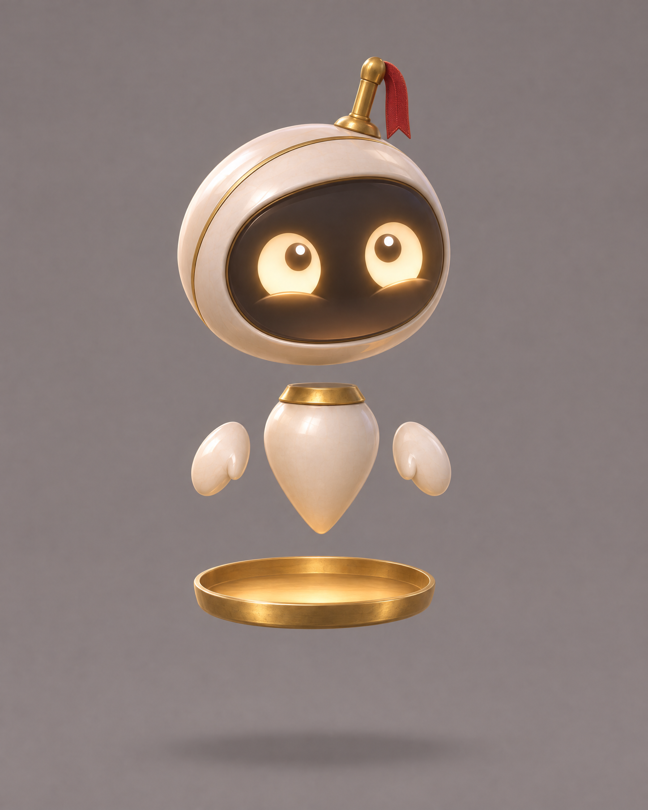
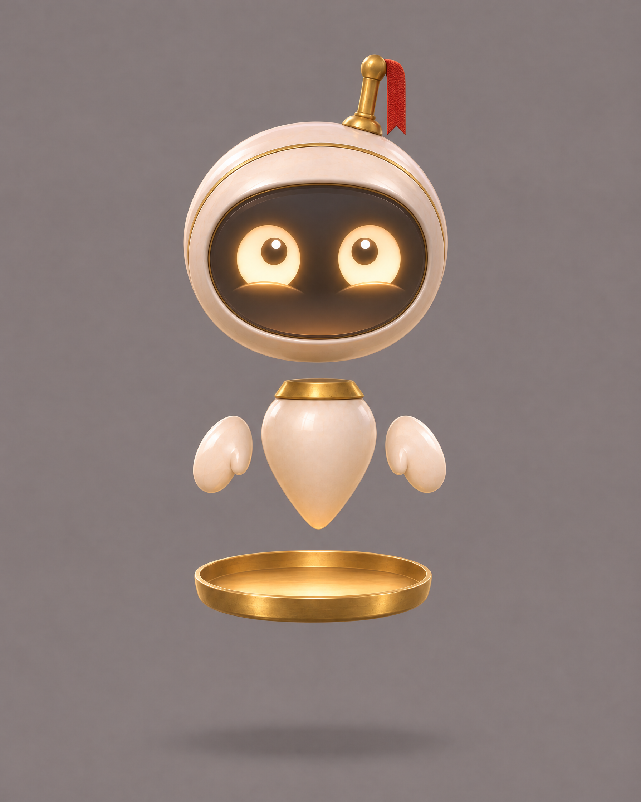
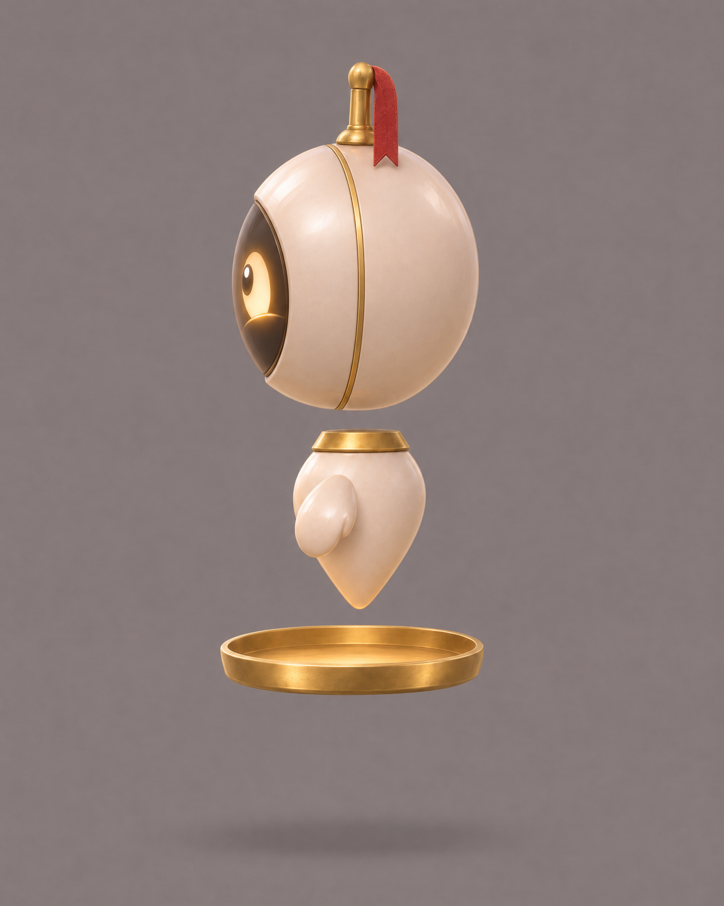
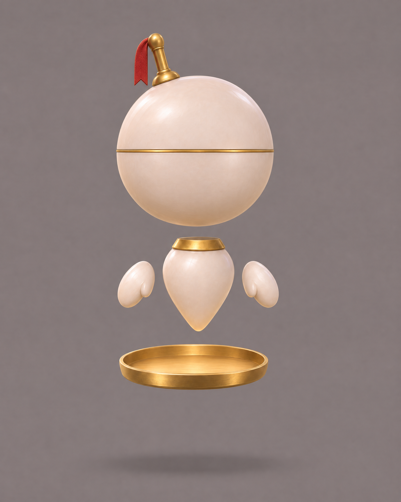

# Selected A, refinement v01: four-view reference set

16 November 2026. Claude visual-design lane, `task_24d63382be92`, plan steps H1 (refine) and H2 (views). Written under `design/assistant/robot/higgsfield-concepts/selected-a-v01/` only.

**Status.** Owen chose direction A, the porcelain clerk. This folder holds one refined three-quarter reference and matching front, side and back views, all generated, downloaded and viewed. The assessment below is my own, as the author. No Meshy job, 3D generation or Blender work was done in this task.

**Independent review.** A separate Claude reviewer returned **PASS for bounded visual-build readiness**: [../../review/selected-a-v01/review.md](../../review/selected-a-v01/review.md). Root's build decisions that follow from it are in [../../selected-a-build-decisions.md](../../selected-a-build-decisions.md). In short:

- `outputs/02-front.png` is the canonical reference.
- `outputs/04-back.png` is excluded from any generation input, because of its level seam.
- No regeneration is required.
- The body cap must be built natively as a closed, slightly domed brass cap.

That pass covers the look and the reference set only. It does not approve in-room or phone-size legibility, runtime behaviour, a final mesh, dimensions or a budget.

After the review I corrected two statements in this file that it found to be wrong: the finish row and the head-shape finding. Images, prompts, receipts and [handoff.md](handoff.md) are unchanged.

| Three-quarter (refined hero) | Front | Side | Back |
| --- | --- | --- | --- |
|  |  |  |  |

The round-one image this started from is unchanged: [../outputs/A-porcelain-clerk.png](../outputs/A-porcelain-clerk.png). The parts and build handoff is in [handoff.md](handoff.md).

## Before and after

Compared with the round-one image, looking at the hero and the front view.

| Requested correction | Result | What I see |
| --- | --- | --- |
| Attentive forward gaze | **Mostly fixed** | Pupils are now centred left to right and meet the viewer. They still sit a little high in each eye, so the look is slightly upward. It reads as attentive, not as looking away |
| Bookmark ribbon, not a flag | **Fixed** | A narrow red ribbon with a notched end hangs from a slim brass stalk. It is small and no longer waves |
| Calmer finish, no window reflections | **Partly fixed** | The porcelain is calmer and more satin than round one. But a four-pane window reflection and faint craze lines remain on the body in the hero, and a fainter reflection on the body in the front view. These are corrections for the native build: plain porcelain with an even sheen, and no reflection or craze lines carried into any texture |
| Closed body top | **Partly fixed** | The body now ends in a brass collar with a flat top. The top face is dark in every view, so it can still be read as a recess or an open urn. It is not the rounded closed top I asked for. This is a correction for the native build: a closed, slightly domed brass cap |
| Keep the lower-lid expression | **Kept** | Both eyes keep the raised lower lid with a lit edge. It still looks keen and warm |
| Keep the gaps | **Kept** | Head, body, both hands and tray float apart with clear space between them |
| Empty tray | **Done** | No cards. The tray is an empty brass dish with a soft glow inside |
| Neutral hands | **Done** | Both mittens hang level and mirrored. Round one had one raised |

Other differences from what I asked for:

- **The hero is closer to a front view than a three-quarter.** The head is turned only slightly, and still tips a little to one side. I asked for a level head.
- **Eye glow spills onto the face panel** below each eye. That is a render bloom, not a shape.
- **Identity held.** Same head, face panel, eyes, body, mittens, tray and palette as round one. Nothing drifted toward the v02 ring eyes or toward direction C's materials.

## Consistency across the four views

Good:

- Palette, materials and overall scale match in all four. The tray is the same width in each.
- The stalk sits on the character's own left side of the head in the hero, front and back views, with the ribbon beside it.
- Body, collar, mittens and tray match in all four. The mitten thumbs point inward in front and back, as mirror images should.
- The eyes, pupils and lower lids match between hero and front.

Points to settle before or during modelling. Items 1, 3 and 4 are real disagreements between views; item 2 is minor; item 5 applies to all:

| # | Issue | Where | Proposed resolution |
| --- | --- | --- | --- |
| 1 | **Brass seam direction.** Hero, front and side show a seam that rings the head a little behind the face, like the join of a helmet. The back view shows a level seam round the equator instead | Back against the other three | Follow the three that agree: one ring behind the face. The back of the head is then plain porcelain. Do not model the equator seam |
| 2 | **Head shape: a small spread, not a conflict.** The independent reviewer measured the head in each image. It is about 10% wider than tall from the front, and about as deep as it is tall from the side. The views agree to within roughly 5 to 10%; the back view is a little rounder. My first reading of this as a strong disagreement was wrong | All four, minor | Build a ball about 10% wider than tall, with depth about equal to height. These are ratios read from perspective images, not flat views and not metre measurements |
| 3 | **Face panel depth.** Hero and front show a dark panel set into the head. The side view shows a clear dome bulging forward with the eye sitting behind it | Side against front | Treat the face as an opaque dark surface, flush or slightly inset, with the eyes on it. This also suits a room that avoids see-through materials |
| 4 | **Stalk and ribbon.** Front and back show the stalk leaning outward with the ribbon hanging to the side. The side view shows an upright stalk on the centre line with the ribbon hanging to the rear | Side against front and back | Follow front and back for position. Pick one hang direction when modelling |
| 5 | **Not true flat views.** Every image looks slightly down onto the tray while looking level at the head | All four | Use the images for shape and finish, not for measuring heights or the tray's tilt |

**Is the set usable?** Yes for agreeing the look and for guiding a native build, with the points above settled by the build decisions linked at the top. As raw input to an image-to-3D tool the full set of four carries a risk: issue 1 could put two brass seams on the head, and issue 3 could produce a glass bubble. The review resolves this without new images: use the front view as the canonical input and leave the back view out. I had suggested regenerating the back view; that is not needed.

## Receipts

| | 01 three-quarter | 02 front | 03 side | 04 back |
| --- | --- | --- | --- | --- |
| Job ID | `f91d757b-6622-44af-a4d9-4e117ffd27a5` | `58f02d8a-b76a-4f35-a730-bbe5230ed469` | `43a0b949-25b9-4ad5-b46e-8c01464b6f6e` | `5b7d2704-aae0-4534-9747-67111e569059` |
| Reference input | Uploaded media `552c7ac4-7e80-48f6-83b9-dc2ffced20a3` | Job `f91d757b-…` (image 01) | Job `f91d757b-…` (image 01) | Job `f91d757b-…` (image 01) |
| File | [01-three-quarter.png](outputs/01-three-quarter.png) | [02-front.png](outputs/02-front.png) | [03-side.png](outputs/03-side.png) | [04-back.png](outputs/04-back.png) |
| Bytes | 4,070,774 | 4,037,510 | 3,957,524 | 3,924,839 |
| SHA-256 | `a187617976eaaa61b7173798a05b2e845a4f9205e9f72fe4250452cff66f3458` | `9b94d861e18d5c95f439847e30a81aa7a036110f0105585a8914126bfc9c8cc7` | `d33e551a1018d70e155ec2dba413ee296050918f20c7b440df550e3f367864bd` | `d6384f1cf0616587a138f6b8f8ebd859fc2f10ee580db5231ab35a270e89c541` |

- **Settings, all four:** Higgsfield `generate_image_batch`, model `gpt_image_2_6`, aspect 4:5, quality high, resolution 2k, PNG, one image per job, one reference image in the `image_references` role. All outputs are 1792x2240.
- **Reference identity for image 01:** the uploaded media is my local `../outputs/A-porcelain-clerk.png`, SHA-256 `30d240dd445cddd27a2f8ee09204f68e6cea1cd127944e7bc1ef071e284f9ef0`, uploaded by presigned PUT (HTTP 200) and confirmed.
- **Consistency mechanism:** the three later views each use image 01's job as their only reference, plus one shared identity paragraph. The workflow offers no seed or locked-identity control for this model, so none was invented.
- **Prompts:** [hero-prompt.txt](hero-prompt.txt) is the exact string for image 01. [view-prompts.txt](view-prompts.txt) holds the shared paragraph and the three view clauses; each submitted prompt was the view clause, one space, then the shared paragraph.
- **Workflow:** I loaded Higgsfield's `character-sheet` instructions (version 1.0) and followed their order: view first, then "identical original character", then parts, finish, lighting and exclusions. Two deliberate departures: separate images in place of a tiled sheet, as the task asked, and a mid-grey backdrop in place of pure white, so the white porcelain keeps its outline.
- **Cost:** preflight quoted 2.75 credits for image 01 with its reference. Stage one used 2.75 and stage two 8.25 (three images). Balance went from 1146.25 to 1135.25: **11.0 credits used**, from existing plan credits. I did not run a separate preflight for stage two; the settings were the same and the balance confirms the price. No allowance choice was asked for, nothing was bought, and no generation was retried.
- **Downloads:** unmodified originals from the job result URLs. Several download and upload attempts hit connection resets and were retried; those were transfers only.
- **Round-one files unchanged:** `A-porcelain-clerk.png` `30d240dd…9ef0`, `prompts.md` `b5d9409b…10ae`, `README.md` `89493ecf…57b1`, the same as before this task.

## Limits

- Four single stills. No pose, expression or tray-state variants exist for A yet.
- The room baseline file `integration/baseline-2026-11-16/baseline.md` was not present when I looked, so nothing here is sized or checked against the room.
- No phone-size or in-room check has been made. I did not shrink these images to simulate one.
- Sizes, part counts and clearances in the v02 documents describe the old blockout, not this character.
