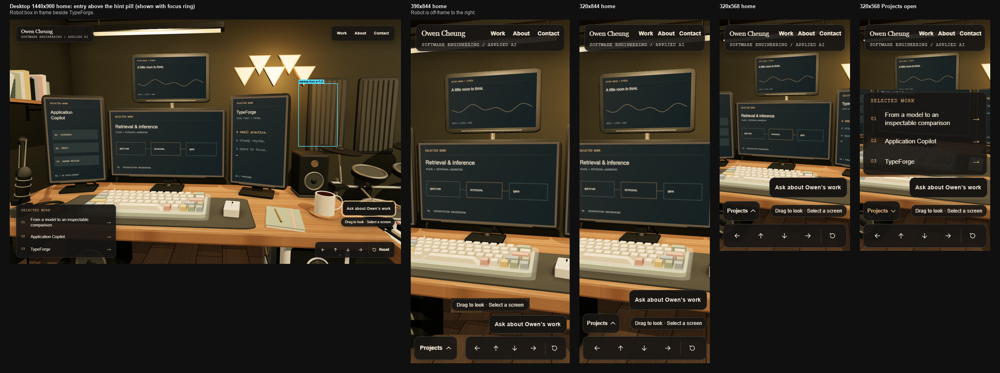
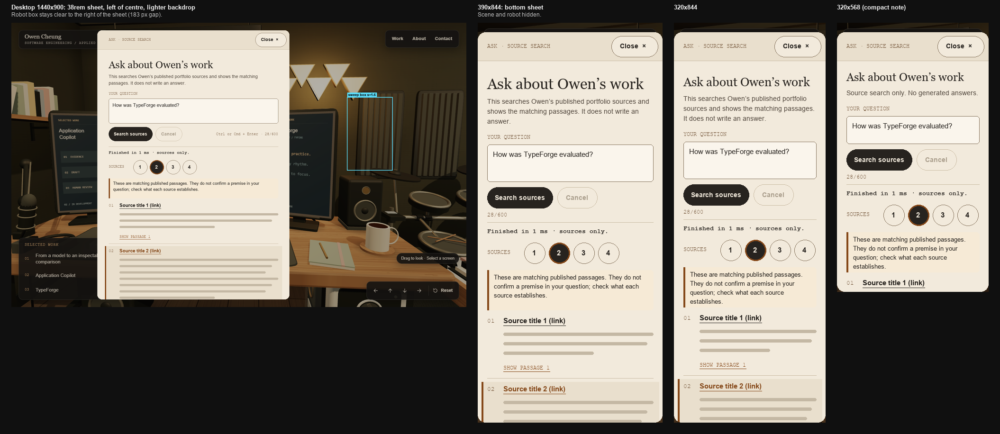
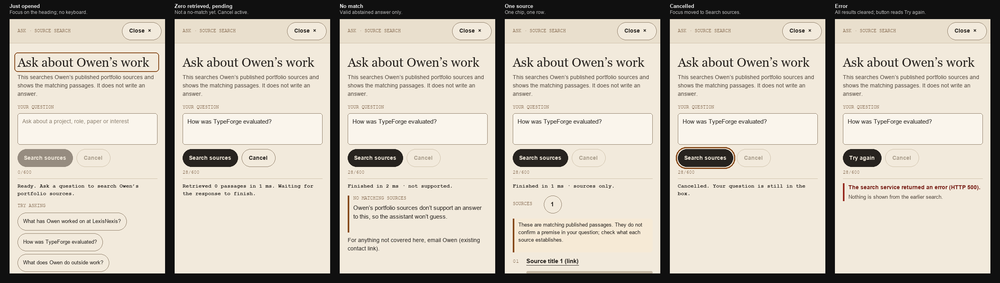

# Selected A: Studio Ask entry, sheet and selected-source cue

16 November 2026. Claude design lane, `task_029efad1da5a` (P2). Design only; no application code was written. Placement is in [placement.md](placement.md).

**What this is.** Layouts and state rules for a Studio-only Ask sheet. It is a controlled view of the existing run: it reads one `PresentationSnapshot` and calls the four existing actions (`submit`, `cancel`, `close`, `select`) from `lib/assistant/run-state.ts`. It adds no request flow, no store and no generated answer.

**Not checked.** The sketches are drawings made with a script over real captures. They were not rendered by a browser, so text wrapping, focus rings and the phone keyboard still need the prototype.

## 1. Entry

One HTML button, labelled **Ask about Owen's work**, on the Studio page only.

| Size | Position | Height |
| --- | --- | --- |
| Desktop | Right column of the dock, in a new row above the hint pill | 48 px |
| 390x844 | Its own row, right-aligned, directly above the Projects and look row. The hint pill keeps its own row above | 44 px |
| 320x844 and 320x568 | Its own row, right-aligned, above the Projects and hint row | 48 px |

- **Style:** the existing dark plate (`--plate`, `--plate-line`, 0.8rem radius, same shadow), 0.9rem bold cream text, like the section links.
- **Projects open on a phone:** the Projects list sits above the entry row, so both stay usable. On the 320x568 screen the list then starts 56 px higher and covers the lower part of the raised screen; it does not reach the header.
- **Scene cost:** the row is empty apart from the button, so it covers only a strip of desk at the right.
- **Markup:** a real `<button type="button" aria-haspopup="dialog">`. Enter and Space work natively. No hover-only behaviour.
- **Always available:** the button does not depend on the character being in view, on the scene having loaded, or on WebGL working. If the room fails, the button and sheet still work.
- **Before scripts run:** the existing `/ask` link on the page stays as the fallback. The button appears only once the page is enhanced.
- **Clicking the character** is not part of this design. If root adds it later, it must run the same handler, and focus must return to this HTML button on close.

## 2. Sheet

The sheet is a view inside root's single native dialog. It reuses the project sheet's paper style: `--paper`, `--paper-deep` bar, `--ink` text, the same Close pill and the `#854819` focus colour.

| Size | Layout |
| --- | --- |
| Desktop, 48rem and wider | Width `min(38rem, 100% - 3rem)`. Left edge at `max(1.5rem, 50% - 28rem)`. Height up to `100dvh - 3rem`. At 1440x900 that is x 272 to 880 |
| Under 48rem | Full-width bottom sheet, same height rule as the project sheet. Side padding 1.25rem |
| Height 34rem or less | Same sheet; the scope note shortens to one line |

- **Desktop position.** The sheet sits left of centre so the character stays visible to its right. The gap to the sweep box is 183 px at 1440x900, 133 px at 1024x768 and 108 px at 1280x720, by calculation.
- **Desktop backdrop.** I propose a lighter backdrop for this view, about 0.32 opacity against the project sheet's 0.56, so the character can still be read. Root owns the dialog and decides.
- **Phones.** The sheet covers the scene. The character is not visible while the sheet is open, so everything is carried by the HTML.

### Contents, top to bottom

1. **Bar:** label `ASK · SOURCE SEARCH` and the Close button.
2. **Heading** (`h2`, `tabindex="-1"`): "Ask about Owen's work". Serif, 2rem on desktop and 390, 1.6rem at 320, 1.5rem on short screens.
3. **Scope note:** "This searches Owen's published portfolio sources and shows the matching passages. It does not write an answer." Short screens: "Source search only. No generated answers."
4. **Question:** label "Your question", a textarea (3 rows; 2 on short screens), 600 character limit, the existing placeholder.
5. **Buttons:** **Search sources** (ink fill) and **Cancel** (outline). Then the count, such as `28/600`. Desktop adds "Ctrl or Cmd + Enter".
6. **Status line:** one live region. Text comes from the snapshot (section 4).
7. **Results:** only when the snapshot has them (section 3).

Buttons, chips and links are at least 44 px high. At 320 px the two buttons take 242 px of the 280 px column and the count drops to its own line.

## 3. Results and the selected-source cue

- **One list.** One row per entry in `run.hits`, in the order given, zero to four. Never padded, trimmed or reordered. Rows appear as soon as retrieval arrives, all together.
- **Row:** rank (`01`), the source title as a link to its `href`, the passage clamped to three lines, and a **Show passage N** button.
- **Chips.** A row of numbered chips labelled `SOURCES`, one per hit. They are the HTML twin of the cards on the tray: chip 2 and card 2 are the same hit.
- **Identity.** Rows and chips are keyed by `view.key`. The rank is display only.
- **Selecting.** A chip or a row's Show button calls `actions.select(run.runId, key)`. Pressing it again calls `actions.select(run.runId, null)`. One selection at a time.
- **Caution note.** When `result` is `sources`, the existing sentence shows above the rows: "These are matching published passages. They do not confirm a premise in your question; check what each source establishes."

**The cue for the selected source, from `run.selectedKey`:**

| Where | Cue |
| --- | --- |
| Chip | Ink fill, paper numeral, 3 px `#854819` ring, `aria-pressed="true"` |
| Row | `--paper-deep` background, 3 px `#854819` rule on the left, full passage shown, button reads **Hide passage N** |
| Tray card | The matching card lifts slightly and takes the room's selected colour (`#ffc779`, as on a selected project screen). One finite move, then still. Display only |

- Selection moves focus to that row's button, as `/ask` does today, and scrolls it into view.
- The cards are never clickable while the dialog is open. The background is inert, and selection comes only from the chips and rows.
- On phones the card cue is hidden with the scene. The chip and row cues are complete without it.
- Colour is never the only signal: the chip has `aria-pressed`, the row changes its button text and length.

**Source links.** The title link uses the hit's own `href`. A link that leaves the Studio is ordinary navigation, and the question is not saved. If a link targets a Studio project, root closes Ask first (`actions.close()`), then opens the project, so only one sheet is ever open.

## 4. States

Everything is read from the snapshot. Nothing is animated to suggest work in progress: no spinner, skeleton rows, typing effect, progress bar or step tracker. The `/ask` pipeline diagram and its "Generate" step are left out of this sheet.

| Snapshot | Status line | Results area | Buttons |
| --- | --- | --- | --- |
| `phase: idle` | "Ready. Ask a question to search Owen's portfolio sources." | The three existing example questions | Search sources; Cancel inactive |
| `requesting` | "Sending your question…" | Empty | Cancel active |
| `retrieving` | "Searching portfolio sources…" | Empty | Cancel active |
| `result: pending`, count 1 to 4 | "Retrieved N passages in X ms. Waiting for the response to finish." | Chips and rows | Cancel active |
| `result: pending`, count 0 | "Retrieved 0 passages in X ms. Waiting for the response to finish." | Empty. **Not** a no-match | Cancel active |
| `result: sources`, complete | "Finished in X ms · sources only." | Caution note, chips, rows | Cancel inactive |
| `result: no-match` | "Finished in X ms · not supported." | The existing no-match sentence and the existing contact line | Cancel inactive |
| `completion: missing-done` | "Response received." plus the snapshot's notice | As for the answer received | Cancel inactive |
| `phase: cancelled` | "Cancelled. Your question is still in the box." | Empty | Cancel inactive |
| `phase: error` | `run.notice`, shown as an alert | Empty; nothing from the earlier search remains | Main button reads **Try again** |

- **Wording.** "Waiting for the response to finish" replaces the current "Waiting for the answer", which suggests a written answer. That and "Search sources" are my suggestions; the other strings are the ones `/ask` uses now.
- **No-match** appears only for a valid abstained answer. A failure never shows as no-match.
- **Error and protocol failure** clear chips, rows, selection and timings together, and the tray clears in the same snapshot.
- **Example questions** fill the box and submit, as on `/ask`.

### Draft, submit, cancel, retry

- **Draft.** The owning component holds the text. It survives closing and reopening the sheet during the visit. Results do not: `close()` returns the run to idle.
- **Submit.** The button, or Ctrl or Cmd + Enter in the textarea. Plain Enter makes a new line. It calls `actions.submit(draft)`.
- **Empty draft.** The button is marked `aria-disabled="true"` and does nothing. It is not given the `disabled` attribute, so it can always hold focus.
- **Submitting during a run** is allowed; the new run replaces the old one.
- **Retry** is the same button with a different label, and it submits the current draft. There is no separate retry control to appear and vanish.
- **Focus after submit** stays on the button. Results are announced by the status line; focus does not jump into them.

## 5. Focus

| Moment | Focus goes to |
| --- | --- |
| Sheet opens, any size | The heading. Not the textarea, so a phone keyboard does not open unasked |
| Tab from the heading | Textarea, Search sources, Cancel, chips, then each row's link and button |
| Chip or Show passage pressed | That row's button |
| **Cancel pressed** | **The Search sources button** |
| Run ends on its own | Stays where it is |
| Close, Escape | Back to the Ask entry button |
| Ask closed because a project opens | The project's heading; closing that returns to whatever opened the project |

**Cancel, in detail.** The G1 browser check found that on `/ask`, Cancel becomes disabled when pressed and the keyboard focus falls to the page body. For this sheet:

1. Cancel never uses the `disabled` attribute and is never removed. When no run is in flight it is `aria-disabled="true"`, greyed, and does nothing.
2. Pressing it while a run is in flight calls `actions.cancel()` and then moves focus to **Search sources**.
3. The status line announces "Cancelled. Your question is still in the box."

Search sources is the destination because the next step is to run again or edit, it is always present, and focusing it does not open a phone keyboard. This is a rule for the new sheet only. It does not ask for a change to `/ask`.

**Closing.** Close and Escape both call `actions.close()` first, then root closes the dialog and restores focus. Whether a backdrop click closes it should match the project sheet.

**One sheet at a time.** While Ask is open the room, the project list and the screens are inert. Opening Ask from a state where a project sheet is open is not possible for the same reason.

## 6. What the character shows

One snapshot drives both the sheet and the character, in the same commit.

| Snapshot | Character | Tray |
| --- | --- | --- |
| Idle | Neutral | Empty, carried |
| Requesting, retrieving, or zero retrieved and pending | Attention | Empty, carried |
| 1 to 4 hits | Sources | Presented, with exactly that many cards |
| Valid no-match | No-match; the character's own right mitten gestures toward the visitor's left, where the desktop sheet sits | Presented, empty |
| Cancelled or error | Neutral | Empty; cards clear with the HTML rows |
| Sheet closed | Dismissal, then neutral | Empty |

- Cards carry the count. The tray glow is constant (root's decision) and means nothing.
- With reduced motion on, poses change at once. Nothing loops in any state.
- Phones: none of this is visible while the sheet is open. It matters there only before opening and after closing.

## 7. Open points

| Point | Who decides |
| --- | --- |
| Lighter backdrop for the Ask view | Root |
| The two wording changes ("Search sources", "Waiting for the response to finish") | Root or Owen |
| Whether the passage clamp (three lines until selected) is acceptable, since it hides text until asked | Owen |
| Card lift size and colour on the selected card | Codex, in the prototype |
| Phone keyboard covering the textarea on a 568 px screen | Prototype |

## 8. Handoff for the later UI work (G3)

1. Build `AskEntry` and `AskSheet` as controlled components. Props: `snapshot`, `actions`, `draft`, `setDraft`, and root's open and close handlers. No fetch, parser or timer inside them.
2. Add the `ask` grid area to `.dock` at the three breakpoints already in `studio.module.css`, as in section 1.
3. Add an Ask variant of `.panel` for the desktop width, offset and backdrop.
4. Give the heading `tabindex="-1"` and hand root a ref to it and to the entry button.
5. Implement the Cancel rule in section 5 with a ref to the Search sources button.
6. Use `aria-disabled` on Search sources and Cancel, not `disabled`.
7. Put the status line in one `role="status"` region; use `role="alert"` for the error notice.
8. Tests to add with the build: the ten rows in section 4, each of the focus rows in section 5, counts 0 to 4, and the three sizes plus the short screen.

**Root (G4)** owns the dialog, history, scroll locking, focus restore, and delivering the same snapshot to the scene and the sheet together.

**Codex (G2)** owns the cards, the selected-card lift and the pose scheduling in section 6.
