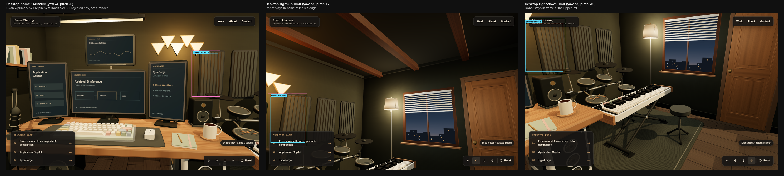

# Selected A: Studio placement proposal

16 November 2026. Claude design lane, `task_029efad1da5a` (P2). Written under `design/assistant/robot/placement-selected-a/` only. The Ask interface is in [ask-interface.md](ask-interface.md).

**Status.** This is a design proposal computed from source coordinates and the build-v01 bounds. Nothing here was rendered in the room. It stays provisional until build-v02 publishes refreshed bounds (coordinator note `msg_a2e0c68accb0`), and until the integration prototype checks occlusion, lighting and phone legibility.

The boxes are the build-v01 five-pose sweep box projected with the room's camera values and drawn over real captures. They are not a render of the character and not a measured in-room clearance.

## The proposal

| | Primary | Fallback |
| --- | --- | --- |
| Anchor, world units (root node) | `[0.80, 2.80, -0.20]` | Same |
| Wrapper scale (uniform) | **1.6** | **1.8** |
| Rotation | Yaw only, -22.62° about +Y | Same |
| Quaternion `[x, y, z, w]` | `[0, -0.19612, 0, 0.98058]` | Same |
| Distance from the fixed eye | 3.90 world units (1.95 m) | Same |
| Character height in the room | 0.43 m | 0.48 m |

- **Where it is.** Hovering above the nearfield speaker at the right end of the desk, between the TypeForge screen and the first acoustic panel. This is the right-speaker zone from my earlier zone sketch; the numbers confirm it.
- **Anchor height.** The root sits at the eye's own height (2.8), so the character is seen level and needs no pitch.
- **Facing.** The yaw turns the character's forward axis (glTF +Z) toward the fixed eye: `atan2(eye.x - anchor.x, eye.z - anchor.z)`.
- **Scale.** The source profile assumes one external scale of 2. I propose 1.6 instead, applied once in the same wrapper, with no floor offset. At 2 the box does not fit between the speaker top and the wall lights.

Nothing in the room moves. Camera, monitors, lights and panels stay as they are.

## Why this spot

Because the eye never moves, what hides what is the same in every view and on every device. I worked in angles from the eye (azimuth, right positive; elevation, up positive) and only then in pixels.

| Neighbour | Its extent from the eye | Sweep box at 1.6 | Margin |
| --- | --- | --- | --- |
| TypeForge casing, right edge | Azimuth 16.96° | Left edge 19.07° | 2.1° (about 30 px at 1440x900) |
| Wall lights, lowest point | Elevation 7.88°, azimuth up to 22.2° | Box top 7.56°; head top about 6.1° | 0.3° for the box, about 1.8° for the head |
| Speaker top | Elevation -7.42° | Box bottom -6.18° | 1.2°; 0.14 world units (7 cm) of air above the speaker |
| Left cymbal, far behind | Elevation -8.4° to -5.9° | Box bottom -6.18° | Overlaps by 0.3° on screen; 1.1 world units apart in depth |
| First acoustic panel, behind | Azimuth 20.5° to 28.4° | 19.07° to 26.30° | Intended backdrop: white porcelain against the dark panel |

Sweep box in world units at 1.6: minimum `[0.506, 2.401, -0.489]`, maximum `[1.102, 3.290, 0.091]`. The TypeForge casing's nearest edge is about 0.15 world units to the left of that box.

Only the stalk and ribbon reach the top of the box, and they sit on the character's own left, which is the viewer's right, away from the lights.

### Other spots I checked

- **Further right, in front of the drum kit, at scale 2.** Clear of the lights, but it is cropped on squarer desktop windows and is stretched to 182 x 284 px at the edge of a 1440x900 frame. Rejected.
- **Beside the raised screen (left).** Fits a 390 px phone only just and does not fit at 320 px. Rejected.
- **On the desk by the mouse.** It would cover the lower part of the main project screen. Rejected.

## What the visitor sees

| View | Sweep box, CSS px | Size | Eye disc / pupil |
| --- | --- | --- | --- |
| Desktop home, 1440x900 | x 1063 to 1205, y 236 to 466 | 141 x 230 | 20.9 / 8.8 px |
| Desktop home, 1024x768 | x 805 to 926, y 202 to 398 | 121 x 196 | 17.8 / 7.5 px |
| Desktop right-up limit | x 29 to 224, y 483 to 744 | In frame, left edge | |
| Desktop right-down limit | x 3 to 217, y 60 to 335 | In frame; the top 22 px of the box pass behind the name plate | |
| Phone home, all three sizes | Off-frame to the right | Not visible | |
| 390x844, yaw 23°, pitch -8° | x 147 to 235, y 234 to 401 | 88 x 167 | 17.4 / 7.4 px |
| 320x844, yaw 23°, pitch -8° | x 112 to 200, y 234 to 401 | 88 x 167 | 17.4 / 7.4 px |
| 320x568, yaw 23°, pitch -8° | x 128 to 187, y 157 to 270 | 59 x 112 | 11.7 / 4.9 px |

- **Desktop.** The character is in the home view and stays in frame up to the right look limit. It leaves the frame only when the visitor looks left past about yaw -15°. At the home yaw it is fully in frame for any window wider than about 1.08 times its height.
- **Phone.** The phone home frame is about 32° wide and is filled by the main project screen, the raised screen and the keyboard. No spot inside it is free without covering a project screen. So on phones the character is **not** in the default view. The visitor finds it by dragging, or with three presses of the right look button (10° each: -13°, -3°, 7°, 17°). It is fully in frame between about yaw 11° and 35° at 390 px, and 14° and 32° at 320 px wide.
- **Ask access never depends on seeing the character.** The HTML Ask entry is always on screen at every size and look direction. See [ask-interface.md](ask-interface.md).
- **Project screens.** The box does not overlap any of the three project screens or the raised screen, in any view. The existing header, Projects list, hint and look controls are clear of it at desktop home.

## The desktop and phone conflict, and the fallback

Desktop wants the character small enough to sit under the wall lights. The short phone wants it bigger: at 320x568 the pupil is 4.9 px at scale 1.6, under the 6 px that the build-v01 notes already call fragile.

**Fallback: same anchor, scale 1.8.** Use it if the prototype shows the eyes do not read on a short phone.

| | 1.6 | 1.8 |
| --- | --- | --- |
| Pupil at 320x568 / 390x844 / desktop | 4.9 / 7.4 / 8.8 px | 5.6 / 8.3 / 9.9 px |
| Desktop home box | 141 x 230 px | 160 x 262 px |
| Margin to TypeForge | 2.1° | 1.6° |
| Box top against the lights (7.88°) | 7.56°, clear | 8.55°, the box corner crosses; head top about 6.8° stays under |
| Air above the speaker | 7 cm | 4.6 cm |

At 1.8 the clearance under the lights rests on the head's shape, not on the box, so it needs the prototype to confirm it.

## Sweep and motion

- The box is build-v01's stated five-pose sweep, including its 0.8 mm allowance. It covers the five poses and the straight blends between them.
- **Not in the box:** runtime source cards on the tray, any hover lift of the root, and shadows. Cards stand on the tray, so I expect them inside the silhouette, but that is not measured.
- Keep any root hover lift within 0.02 world units upward at 1.6. More than that puts the box corner into the lights.
- **Tray.** Seen from the eye, the carried tray is about 5° below eye level, so it reads as a thin brass line. Presenting tilts it toward the visitor and shows the dish. This suits the two tray states. Root has since made the tray glow constant, so the cards alone carry the count.
- **Gaze.** The pupils' full travel (2.4 mm each way) is 0.8 px on desktop and under 0.5 px on a short phone. Gaze shifts will not be visible in the room at either scale. Pose has to read from the head, mittens and tray. This is a finding for the asset review, not something I changed.
- **No-match gesture.** The mitten that points should be the character's own right, which is the visitor's left. On desktop the Ask sheet sits to the visitor's left of the character, so the gesture points at the sheet and its contact line. Keep the same side on phones, where the sheet covers the scene.

## Not established

- Real occlusion, lighting, shadow and contrast in the room. The key light and pendant may wash the porcelain or throw the character's shadow on the TypeForge screen.
- Whether the character reads under the modal backdrop on desktop.
- Phone legibility on a real device.
- Draw calls, shadow cost and transfer size with the character added. No budget is assigned.
- Build-v02 bounds. When they arrive, put the new sweep and neutral bounds into [tools/project.py](tools/project.py) and rerun; the anchor holds if the four margins in the table above stay positive.

## How the numbers were made

- **Camera:** fixed eye `[-0.7, 2.8, 3.4]`, 58° desktop and 64° phone vertical field of view, home and limit angles from `components/studio/scene/view-config.ts` and the capture index. Small layout applies at width 640 px or less, or aspect under 0.9.
- **Room objects:** positions and sizes read from `components/studio/scene/build-studio.ts` (monitors, speaker, wall lights, acoustic panels, drum kit, pendant). I used simple boxes around each.
- **Check:** I projected the TypeForge casing, the speaker, the main and raised screens and the wall lights, then compared them with the real captures at 1440x900 and 390x844. They agree to within about 5 px by eye. That checks the projection, not the character.
- **Character:** build-v01 `fullSweptBoundsMetres` and `localBoundsMetres`, converted from Blender to glTF axes as the profile states, scaled, turned by the yaw, then projected.
- **Eye and pupil sizes:** from the raw eye radii in `poses.json` and the profile's metres-per-raw-unit. They are estimates of the central size, as in the build-v01 notes.
- Scripts: [tools/project.py](tools/project.py) (projection) and [tools/sketch.py](tools/sketch.py) (drawings). Both are plain Python with Pillow; they read captures and write only to `sketches/`.

## Evidence I opened

| File | SHA-256, first 16 |
| --- | --- |
| `integration/verification-g1/studio/1440x900-dpr1-home.png` | `b55b0f2b4f425c25` |
| `…/1440x900-dpr1-project-dialog.png` | `cc3b190482d05a6c` |
| `…/390x844-dpr1-home.png` | `16f6407538466a2c` |
| `…/320x568-dpr1-home.png` | `e7da9f2e4731c005` |
| `…/320x568-dpr1-projects-open.png` | `d46b51f550d771c6` |
| `asset-pipeline/selected-a-v01/candidate-001/build-v01/neutral-contact-sheet.png` | `cf65edf645cd34ff` |
| `…/build-v01/five-poses.png` | `551db1ccd3ef7050` |
| `…/build-v01/profile.json` | `3c8d967715892f5e` |
| `…/build-v01/poses.json` | `6e32e89bd68e47ea` |

- **Seen only inside my own sketches, not opened on their own:** `1440x900-dpr1-right-up.png` (`f653ebef7fb3a303`), `1440x900-dpr1-right-down.png` (`0e372bb286a5ad6e`), `320x844-dpr1-home.png` (`0d0b20b7dc1452aa`).
- **Not opened:** the left look limits, the phone look limits, the other Projects-open and dialog shots, and all DPR 3 shots. At the phone right limits the character is off-frame to the left by calculation.
- **Also opened:** `claude/placement-zones.png`, two `/ask` captures in `integration/verification-g1/ask/` (`focused-real-1440-top.png`, `focused-real-390-citations.png`) and the G1 report.
- **Read:** `integration/verification-g1/studio/index.md`, `integration/baseline-2026-11-16/baseline.md`, `integration-decisions.md`, `integration/shared-state-implementation.md`, `selected-a-build-decisions.md`, `personality-direction.md`, the build-v01 README, `lib/assistant/run-state.ts`, `app/studio/studio.module.css`.
- **Not reread in this task:** `design-direction.md` and `integration/state-contract.md`. I relied on the implemented `run-state.ts` and the shared-state handoff for the snapshot, and on my earlier D1 alignment for the contract.
- I viewed all four sketches in `sketches/` after drawing them.

## Handoff

**Codex, scene and loader (G2)**

1. Add one placement wrapper: position `[0.80, 2.80, -0.20]`, quaternion `[0, -0.19612, 0, 0.98058]`, uniform scale 1.6. Keep the three values in one place so 1.8 is a one-line change.
2. Do not add the pilot room's floor offset. Do not scale twice.
3. Recompute the margins from build-v02 bounds before the prototype.
4. In the prototype, capture desktop home, desktop right limits, and phone at yaw 17° and 27° at all three phone sizes, at both scales.
5. Report the shadow on the TypeForge screen and speaker, and the draw and triangle cost.

**Root (G4)**

1. Decide 1.6 or 1.8 after the phone captures.
2. Decide whether the lighter Ask backdrop in [ask-interface.md](ask-interface.md) is acceptable for the single dialog.

**Later Claude UI work (G3)** is listed in [ask-interface.md](ask-interface.md).
